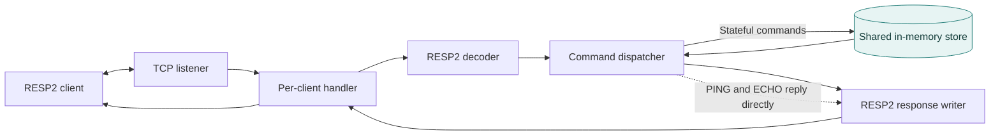
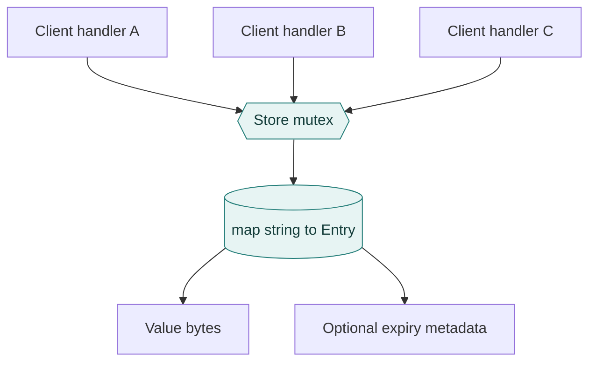
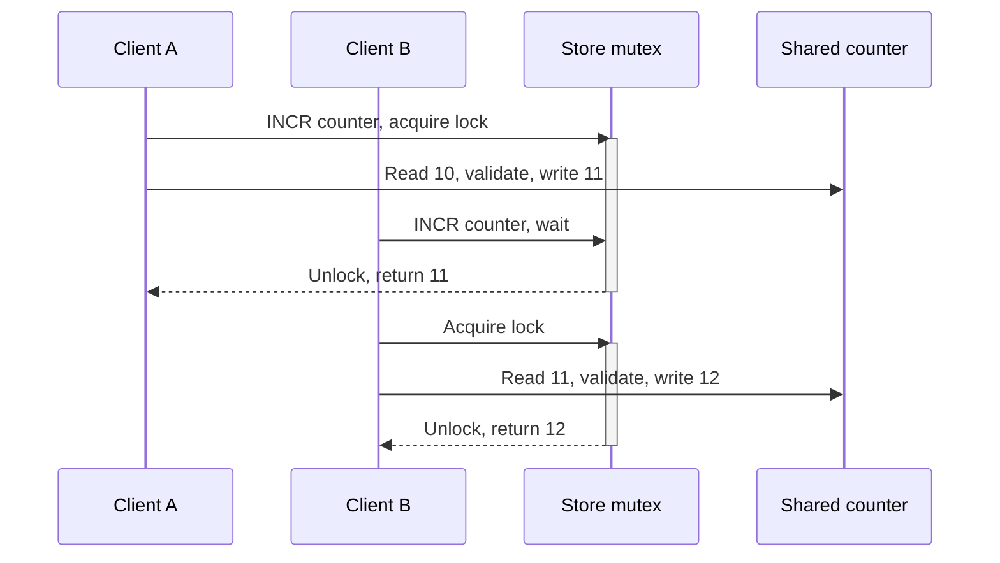
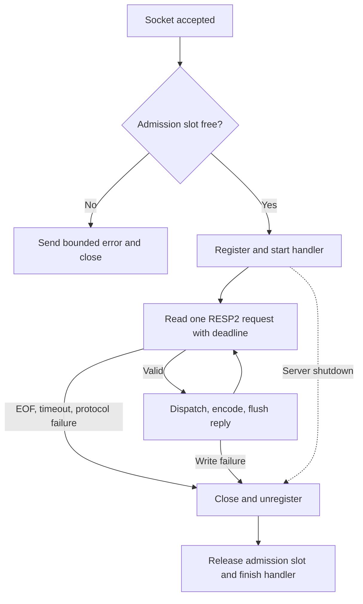
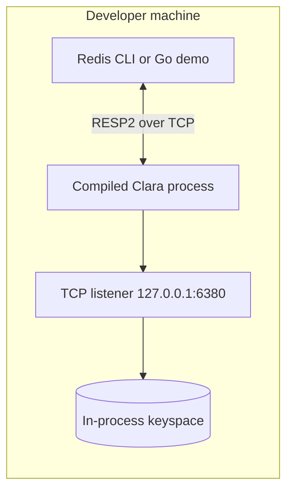

# Clara — Building an In-Memory Database Server from Scratch

> **Engineering case study · October 2026 · Go / TCP / RESP2 / Database internals**  
> **Role:** Independent developer · **Status:** Completed, locally verified portfolio MVP  
> **Source:** [GitHub repository](https://github.com/sultanshahdev/Clara) · **Runtime:** Standalone TCP service, localhost by default

## 1. Project overview

Clara is a Redis-inspired, in-memory key-value database server I built in Go to understand what happens *inside* a database rather than simply calling one from an application. It accepts network connections, decodes a deliberately limited subset of Redis Serialization Protocol version 2 (RESP2), executes commands against a shared binary-safe store, and returns protocol-correct replies. Its ten commands cover connectivity, key-value reads and writes, deletion, existence checks, atomic integer counters, and key expiration.

The engineering challenge was not to reproduce Redis. It was to build a small but complete server whose behavior remained correct when messages arrived in fragments, several clients touched the same key, values expired, or clients disconnected unexpectedly. I used Go's standard library throughout and tested both the storage engine and the executable over actual TCP connections.

| At a glance | Details |
| --- | --- |
| **Project** | Clara — Redis-inspired in-memory database server |
| **My contribution** | Independent design, implementation, tests, documentation, and local verification |
| **Development** | Milestone-based MVP, M0–M8; Git commits recorded on **22 October 2026 (UTC)**; final local audit documented **23 October 2026** |
| **Original time constraint** | Approximately two-day MVP target; **not** a verified hours-worked figure |
| **Language and stack** | Go 1.27, TCP (`net`), buffered I/O (`bufio`), RESP2, `map[string]Entry`, `sync.Mutex`, goroutines |
| **Dependencies** | No third-party Go runtime packages |
| **Public source** | [sultanshahdev/Clara](https://github.com/sultanshahdev/Clara) |
| **Execution model** | Local compiled process listening on `127.0.0.1:6380` by default |
| **Release evidence** | Local build, tests, race detector, vet, standalone TCP demo, clean-checkout verification; [one successful GitHub Actions run](https://github.com/sultanshahdev/Clara/actions/runs/39847544054) for the published final commit |
| **Boundaries** | No persistence, transactions, replication, authentication, TLS, global memory cap, or full Redis compatibility |

**Selected outcomes:** ten supported commands; shared binary-safe storage; atomic 64-bit counter updates; lazy time-to-live (TTL) semantics; bounded RESP requests and connections; and a separate TCP demo that validates the running executable. A particularly useful correctness test reached exactly **2,000 increments from 20 concurrent TCP clients**. This is a correctness result—not a throughput benchmark.

## 2. The problem: what lies beneath a database API?

As an application developer, storing data is often a single library call: `SET`, `GET`, or an ORM method. Those calls hide the work required to parse a request, find a key, synchronize updates, manage memory, and report a result across a network. I wanted to make those hidden responsibilities concrete.

The problem I defined was therefore specific: **build a standalone key-value service that developers can interact with through Redis-style TCP commands, while preserving correct behavior under concurrent requests and invalid network input.** The intended audience is developers learning database internals or experimenting locally with a small in-memory store. There are no established production customers or measured commercial outcomes.

A hash map alone could store a key and value, but it would not solve the database-server problem. Two simultaneous clients might overwrite a counter incorrectly. A single command might arrive over several TCP reads. An empty value must not be confused with an absent key. Keys with expiration deadlines must consistently appear missing after those deadlines. A client that never finishes a request must not hold a server resource forever. These constraints shaped Clara's requirements and architecture.

The practical workflow is simple: start a compiled server, connect through a compatible RESP2 client or Clara's demo program, issue commands, and receive structured replies. The educational goal is deeper: use that small workflow to expose the choices behind protocol handling, concurrency control, storage semantics, and service lifecycle.

## 3. Requirements and scope definition

This was a self-directed engineering project, not a commissioned product. **Requirements gathering** meant defining the problem, selecting an achievable feature boundary, and specifying observable acceptance tests. The available development history does not show external stakeholder interviews, usability research, or a formal customer discovery process; none is implied here.

### Functional requirements

| Capability | Commands | Needed behavior | Acceptance evidence | Outcome |
| --- | --- | --- | --- | --- |
| Connectivity | `PING`, `ECHO` | Confirm reachability and return supplied bytes | TCP replies, repeated requests, binary echo | Implemented |
| Key-value storage | `SET`, `GET` | Write and retrieve binary-safe strings; distinguish missing from empty | Store tests, TCP integration, copy isolation | Implemented |
| Key management | `DEL`, `EXISTS` | Remove or count keys with defined duplicate-key rules | Multi-key unit and TCP tests | Implemented |
| Numeric updates | `INCR`, `DECR` | Atomic signed 64-bit increments/decrements; reject invalid values and overflow | Unit tests; 20-client TCP counter test | Implemented |
| Expiration | `EXPIRE`, `TTL` | Associate deadlines with keys, expire lazily, report remaining lifetime | Fake-clock tests; cross-client expiry tests | Implemented |

The command set was intentionally small. `SET` accepts key and value but not option families such as `NX`, `XX`, or inline expiration. `EXPIRE` accepts a key and integer seconds, without Redis's additional options. Other data types, streams, transactions, search, and administrative commands were outside the MVP.

### Non-functional requirements

| Requirement | Implementation choice | Why it matters |
| --- | --- | --- |
| Concurrency correctness | One shared store protected by `sync.Mutex` | Each storage operation sees consistent mutable state |
| Binary safety | Byte-string protocol arguments, byte-backed values, defensive copies | Arbitrary bytes survive without aliasing or terminator assumptions |
| Network correctness | Incremental RESP2 decoder and ordered replies | Works with fragmented or pipelined TCP input |
| Input boundedness | Header, argument-count, payload, and request ceilings | Prevents large client-controlled allocations |
| Failure isolation | Errors close affected connections, not the whole listener | Healthy clients can continue independently |
| Resource cleanup | Admission cap, deadlines, connection tracking, graceful shutdown | Avoids indefinite blocked handlers and uncontrolled admission |
| Reproducibility | Standard library, Makefile, CI, TCP demo | Another engineer can compile and inspect the work |

**Scope was a technical decision.** Persistence, replication, clustering, consensus, authentication, TLS, eviction, and global memory budgeting are genuine database-system topics—but adding them would have made it harder to finish and test the chosen slice. Instead, I aimed for an end-to-end executable with correctness boundaries I could explain and verify.

## 4. From requirements to evidence

The table connects an engineering objective to the actual package responsible for it and the corresponding test evidence. File links refer to the published repository at the final reviewed state.

| Requirement | Where it lives | How it was checked |
| --- | --- | --- |
| Binary-safe storage and copy isolation | [`internal/store/store.go`](https://github.com/sultanshahdev/Clara/blob/main/internal/store/store.go) | [`TestStoreBasicAndBinarySemantics`, `TestStoreValueCopyIsolation`](https://github.com/sultanshahdev/Clara/blob/main/internal/store/store_test.go) |
| Atomic 64-bit counters | [`Store.changeInteger`](https://github.com/sultanshahdev/Clara/blob/main/internal/store/store.go) | [`TestConcurrentCounters`](https://github.com/sultanshahdev/Clara/blob/main/internal/store/store_test.go), [`TestConcurrentCounterClients`](https://github.com/sultanshahdev/Clara/blob/main/test/integration_test.go) |
| Lazy TTL semantics | [`Store.Expire`, `Store.TTL`, `Store.live`](https://github.com/sultanshahdev/Clara/blob/main/internal/store/store.go) | [`TestExpirationWithFakeClock`](https://github.com/sultanshahdev/Clara/blob/main/internal/store/store_test.go), TCP expiration tests |
| RESP2 framing and replies | [`internal/resp/codec.go`](https://github.com/sultanshahdev/Clara/blob/main/internal/resp/codec.go) | [`TestDecodeFragmentedAndPipelined`, `TestResponseEncoding`](https://github.com/sultanshahdev/Clara/blob/main/internal/resp/codec_test.go) |
| Connection limit and deadlines | [`internal/server/server.go`](https://github.com/sultanshahdev/Clara/blob/main/internal/server/server.go) | [`TestConnectionLimitRejectsExcessAndReusesSlot`, `TestPartialRequestTimesOutAndReleasesSlot`](https://github.com/sultanshahdev/Clara/blob/main/test/integration_test.go) |
| Shutdown correctness | `Server.register`, `Server.Shutdown` | TCP shutdown tests and controlled write-failure test |
| Independent end-to-end usage | [`scripts/demo.go`](https://github.com/sultanshahdev/Clara/blob/main/scripts/demo.go) | [Captured compiled-server demo](https://github.com/sultanshahdev/Clara/blob/main/docs/DEMO.md) |

## 5. System architecture

I divided Clara into four responsibilities: process startup; TCP connection and command handling; RESP2 encoding/decoding; and in-memory storage. This was enough separation to test protocol logic without a network, storage logic without RESP2, and the whole system across real sockets.

- **`cmd/clara`** parses the `-addr` flag, opens the listener, and installs SIGINT/SIGTERM cancellation.
- **`internal/server`** admits clients, starts connection goroutines, owns a shared store, dispatches commands, and manages shutdown.
- **`internal/resp`** decodes request arrays and serializes simple strings, errors, integers, bulk strings, and null bulk strings.
- **`internal/store`** owns the keyspace, mutex, counters, and expiration semantics.

### Diagram 1 — The core request path

`PING` and `ECHO` can reply directly through dispatch, whereas stateful commands call the shared store. Replies are serialized by the same connection handler; the diagram does not represent a separate encoder service.



Several client handlers can exist simultaneously. They do **not** each maintain a separate database. Every handler uses the server-owned `Store`, making the mutex the explicit synchronization boundary. Commands are processed sequentially within each client connection, so responses preserve that connection's request order.

### Diagram 2 — A SET request from wire to memory

This sequence is a simplified view of the real code path. The application-side encoder runs in the handler after dispatch returns; there is no background response queue.

```mermaid
sequenceDiagram
    participant C as TCP Client
    participant H as Handler
    participant P as RESP2 Decoder
    participant X as Dispatcher
    participant S as Store
    C->>H: RESP2 SET username Clara
    H->>P: Decode next request
    P-->>H: [SET, username, Clara]
    H->>X: dispatch(args)
    X->>X: Validate arity
    X->>S: Set(key, value)
    activate S
    Note over S: Lock mutex; copy value; write map entry; unlock
    S-->>X: Complete
    deactivate S
    X-->>H: Write +OK to buffered writer
    H-->>C: Flush +OK CRLF
```

Separating framing from command semantics means a malformed RESP2 length is rejected by the decoder before any command reaches storage; an otherwise valid command with the wrong number of arguments is rejected by dispatch.

## 6. Storage engine: owning state correctly

The storage engine is the centerpiece of Clara. Its core structure is intentionally small, making ownership and synchronization visible rather than implicit. From [`internal/store/store.go`](https://github.com/sultanshahdev/Clara/blob/main/internal/store/store.go):

```go
type Entry struct {
    Value       []byte
    ExpiresAtMs int64
    HasExpiry   bool
}

type Store struct {
    mu   sync.Mutex
    data map[string]Entry
    now  func() time.Time
}
```

The map gives expected average-case constant-time key lookup. Go strings can contain arbitrary byte sequences, so converting an incoming `[]byte` key to a string preserves binary key identity. Values remain byte slices. `HasExpiry` separates “no deadline” from a deadline whose integer value might otherwise be ambiguous. The `now` function allows the same store logic to work with the real clock or a controlled clock in tests.

**Value ownership matters.** If a caller sent a byte buffer to `SET` and then changed that buffer, the stored database value must not change behind the store's back. Clara copies values during `Set` and copies them again on `Get`. This prevents accidental aliasing between client buffers and stored memory. A missing `GET` returns a null bulk reply, while a present zero-length value returns an empty bulk reply—an important semantic difference.

`DEL` and `EXISTS` illustrate why database semantics extend beyond a map API. Repeated keys are counted differently: `DEL key key` removes an existing key only once, while `EXISTS key key` counts that existing key twice. Both operations hold the mutex for the complete multi-key operation, so concurrent requests do not interleave halfway through one store-level call.

### Diagram 3 — Multiple handlers, one synchronized keyspace



I used **one mutex**, not per-key or sharded locks. That reduces concurrency in write-heavy workloads, but it also makes the guarantees easier to audit: a storage operation owns the relevant shared state throughout its critical section. Importantly, the store lock does not enclose socket reads or writes. Network I/O belongs to the connection handler.

## 7. Protocol engineering: speaking RESP2 over TCP

A usable database server needs an unambiguous wire format. Clara accepts RESP2 arrays whose elements are non-null bulk strings; it implements the response types its ten commands require. For example, `SET username Clara` is represented by these bytes (`\r\n` is carriage-return and line-feed):

```text
*3\r\n
$3\r\nSET\r\n
$8\r\nusername\r\n
$5\r\nClara\r\n
```

`*3` specifies three arguments. `$8` means eight raw bytes follow; the decoder does not search those bytes for a string terminator. That length-prefixing makes values such as `a\x00b` possible. The response to a successful SET is `+OK\r\n`. `GET` returns a bulk string or `$-1\r\n` for a missing key.

The networking detail that drove the decoder design was **TCP's stream semantics**. Sending one logical request does not guarantee that the receiver gets the whole frame in one read. The parser must accumulate or read exactly the declared lengths and leave the remaining buffered bytes for the next command. Clara uses `bufio.Reader` and `io.ReadFull` in an incremental decoder. Pipelined commands are decoded and dispatched one at a time, preserving reply order for that connection.

The decoder rejects unsupported frame types, null bulk arguments, bad CRLF separators, invalid lengths, and size violations. Its default ceilings are **128 bytes per header, 64 arguments, 1 MiB per bulk argument, and 4 MiB per request**. Lengths are checked before allocating a payload buffer. Error responses sanitize newlines so invalid client data cannot inject additional RESP frames through the error text.

These were deliberate limits on a local MVP, not an attempt at full RESP2 compliance. Clara does not implement all Redis commands, RESP3, inline command syntax, or nested request types. The narrower parser surface made it possible to test fragmentation, malformed input, empty values, and reply encoding meaningfully.

## 8. Atomic counters and shared-state correctness

Counters reveal a subtle database problem. Suppose two clients both read a value of `10`, each calculate `11`, and both write `11`. One intended increment is lost. Serializing the complete read–parse–validate–write sequence avoids that race.

Clara implements `INCR` and `DECR` with `changeInteger`. The function locks `Store.mu`, finds the live entry, parses a canonical signed 64-bit decimal value, checks overflow or underflow, then writes the new value before unlocking. A missing key behaves as zero. Invalid stored values or overflowing operations produce errors without overwriting the old value. Updating only `Entry.Value` retains any existing expiration deadline.

A selected excerpt, simplified only by omitting surrounding function lines, shows the essential protection:

```go
s.mu.Lock()
defer s.mu.Unlock()
// ... read existing value and parse strict int64 ...
if delta > 0 && value == math.MaxInt64 { return 0, ErrOverflow }
if delta < 0 && value == math.MinInt64 { return 0, ErrOverflow }
value += delta
entry.Value = []byte(strconv.FormatInt(value, 10))
s.data[name] = entry
```

*Illustrative excerpt based on the implementation; comments replace omitted original lines.* The lock does not make Clara a transactional or distributed database; it makes each supported storage operation atomic **inside this one server process**.

### Diagram 4 — Two clients increment one counter



The tests check more than a few sample operations. [`TestConcurrentCounterClients`](https://github.com/sultanshahdev/Clara/blob/main/test/integration_test.go) starts **20 TCP clients**, each sending **100 INCR commands** against the same key, and asserts that `GET` returns **2,000**. Another test checks **32 clients × 25 increments = 800**. Those exact totals demonstrate the absence of lost updates in the tested runs; they do not measure maximum requests per second.

## 9. Expiration as database semantics

A temporary key must stop being visible after its deadline, regardless of which client reads it. Clara stores an optional absolute Unix-millisecond deadline with each entry and checks expiration during operations that encounter the key. This is **lazy expiration**: an expired entry becomes logically absent and is deleted on access, without a background scanning goroutine.

The `live` helper checks `now >= ExpiresAtMs` while the store mutex is held. `TTL` returns `-2` for missing/expired keys, `-1` for persistent keys, or remaining time rounded to seconds. `EXPIRE` with a non-positive duration removes a live key immediately. Arithmetic checks reject expiry values that would overflow the stored deadline.

Two interactions were important to preserve across commands. Plain `SET` replaces the entry and therefore clears a previous TTL. In contrast, `INCR` and `DECR` update the value while preserving the entry's expiration metadata. These details prevent superficially correct commands from producing inconsistent database behavior when combined.

### Diagram 5 — Key lifecycle

```mermaid
stateDiagram-v2
    [*] --> Missing
    Missing --> Persistent: SET key value
    Persistent --> Expiring: EXPIRE key seconds > 0
    Expiring --> Expiring: EXPIRE refresh
    Expiring --> Persistent: SET overwrites value
    Expiring --> Missing: Deadline reached; next key access
    Persistent --> Missing: DEL or EXPIRE 0
    Expiring --> Missing: DEL or EXPIRE 0
    Missing --> Persistent: SET recreates key
```



The diagram distinguishes **deadline passage** from physical reclamation: once a deadline has passed, the next operation touching that entry observes it as absent and removes it. Untouched expired entries may remain in memory. That is an explicit memory-management tradeoff.

The store's clock is injectable through `NewWithClock`, making expiration tests deterministic. Tests can advance time to exactly a deadline and assert the result immediately, rather than sleeping and hoping a timer fires. This matters for boundary conditions, TTL rounding, refreshing expiration, and visibility across separate TCP clients.

## 10. TCP client lifecycle and failure isolation

One goroutine handles each admitted connection. Within it, Clara establishes a fixed deadline for the *complete next request*, decodes and dispatches one command, sets a response write deadline, flushes the reply, and repeats. Requests within the same connection stay sequential; different connections can be active simultaneously.

Reliability hardening added a **128-active-client default cap**, configurable for embedded/test server constructors. Admission uses a buffered channel of slots, so excess sockets can receive a bounded error and close without starting another waiting handler goroutine. Handler cleanup releases the slot and removes the connection from the tracked set.

The default **30-second read deadline** limits incomplete or silent requests; the **5-second write deadline** limits replies to clients that stop reading. A fixed deadline per request prevents a slow sender from extending a partial request forever by sending one byte at a time. Invalid framing, timeouts, EOF, and write failures terminate the affected connection rather than the whole service.

### Diagram 6 — Connection lifecycle



### The shutdown registration race

An actual concurrency issue appeared in M6: connection registration and `WaitGroup.Add` could conflict with shutdown waiting for active handlers. If shutdown began after a handler was considered absent but before its `Add`, the wait/accounting sequence could be unsafe. The correction places registration and its matching `wg.Add(1)` under the same server mutex while shutdown marks the server as closing under that mutex. No handler is registered once the closing state is visible.

Shutdown then closes the listener, closes tracked sockets to unblock I/O, and waits for handlers outside the connection mutex. Tests cover shutdown with active and partially written requests, connection churn, and slot reuse. This was one of the clearest lessons of the project: correct data synchronization alone does not guarantee a correct *service lifecycle*.

## 11. Development chronology: nine scoped milestones

The recorded plan divided work into M0–M8. Git history supports this order; all listed milestone commits in the published repository have author timestamps on **22 October 2026 UTC**. The release checklist was written with a local audit date of 23 October. The original “two-day MVP” was a planning constraint, not a measured effort claim.

| Phase | Objective and engineering work | Evidence / acceptance | Representative commit |
| --- | --- | --- | --- |
| **M0 — Foundation** | Initialize Go module, repository layout, Makefile, CI, `AGENTS.md`, and project context | Format/test/vet/build scaffold; code-only Graphify | [`235eb0b`](https://github.com/sultanshahdev/Clara/commit/235eb0bc85) |
| **M1 — Networking** | TCP listener, goroutines, RESP2 PING, signal shutdown | Fragmented/repeated/pipelined PING over TCP | [`d67c492`](https://github.com/sultanshahdev/Clara/commit/d67c492fae) |
| **M2 — Protocol** | Incremental RESP2 parser, response writers, request limits | Frame bounds, malformed requests, encoding tests | [`d484a3d`](https://github.com/sultanshahdev/Clara/commit/d484a3dda9) |
| **M3 — Storage** | Shared binary-safe map, SET/GET/DEL/EXISTS/ECHO, defensive copying | Storage and cross-client TCP tests | [`dbcf72e`](https://github.com/sultanshahdev/Clara/commit/dbcf72ee2c) |
| **M4 — Counters** | INCR/DECR, canonical int64 parsing, atomic updates | 20 × 100 concurrent increments | [`6e737aa`](https://github.com/sultanshahdev/Clara/commit/6e737aa5f3) |
| **M5 — TTL** | Expiration metadata, EXPIRE/TTL, fake clocks and cross-client behavior | Deterministic and malformed-input coverage | [`486c8aa`](https://github.com/sultanshahdev/Clara/commit/486c8aa9e0), [`31d0760`](https://github.com/sultanshahdev/Clara/commit/31d0760359) |
| **M6 — Hardening** | Admission cap, fixed deadlines, cleanup, WaitGroup race fix | Cap reuse, timeout, 32 × 25 increments, shutdown | [`f78b1b7`](https://github.com/sultanshahdev/Clara/commit/f78b1b7bae) |
| **M7 — Demonstration** | Rewrite docs and build independent RESP2 TCP demo | All ten commands against compiled server | [`a021bb3`](https://github.com/sultanshahdev/Clara/commit/a021bb3bb1) |
| **M8 — Audit** | Clean-checkout tests, regression verification, release checklist | Local build/test/race/vet/demo audit passed | [`4b626cd`](https://github.com/sultanshahdev/Clara/commit/4b626cdd70) |

The order mattered. Introducing one shared, synchronized store at M3 meant M4 could add atomic counters without replacing the server architecture. Storing expiration metadata in `Entry` meant M5 could attach TTL behavior to existing operations rather than create a second data structure. Protocol bounds from M2 provided a baseline for M6's network resource hardening. M7 and M8 then focused on demonstrating and validating the completed behavior rather than expanding the feature set.

The development record also shows a deliberate acceptance process. M5 was not considered finished after its first implementation commit: additional TCP tests closed gaps involving a binary-NUL expiration argument and recreation after expiration across clients. This distinction between “the code seems complete” and “the acceptance cases pass” shaped the final project.

## 12. Engineering challenges and how I addressed them

### Challenge A — TCP does not preserve message boundaries

**Failure risk:** Treating one socket read as one command would corrupt requests split into fragments or combine adjacent pipelined requests. **Solution:** A buffered incremental decoder reads headers and exactly declared bulk lengths. **Evidence:** [`TestDecodeFragmentedAndPipelined`](https://github.com/sultanshahdev/Clara/blob/main/internal/resp/codec_test.go) and real TCP fragmentation tests. **Lesson:** Protocol framing must be defined above a byte-stream transport.

### Challenge B — Simultaneous updates can lose data

**Failure risk:** Two clients can read the same counter and overwrite each other's increments. **Solution:** Protect the complete read–validate–write sequence with the store mutex. **Evidence:** Exact 2,000 and 800 final counter values from concurrent TCP integration tests. **Lesson:** An “increment” is one logical database operation, not three independently synchronized map actions.

### Challenge C — Expiration is a cross-command contract

**Failure risk:** A TTL might be dropped during counter updates, or an expired key might remain visible to another client. **Solution:** Keep expiry metadata inside `Entry`; route key operations through the `live` check; preserve metadata during numeric updates. **Evidence:** Fake-clock storage tests and [`TestExpirationCommandsOverTCP`](https://github.com/sultanshahdev/Clara/blob/main/test/integration_test.go). **Lesson:** Database features must compose correctly, not merely pass isolated happy-path tests.

### Challenge D — Malformed lengths can become memory problems

**Failure risk:** A client-controlled bulk length could trigger an oversized allocation before the command is validated. **Solution:** Parse integer lengths with overflow checks and enforce bulk/request ceilings *before* allocation. **Evidence:** [`TestDecodeRejectsMalformedTruncatedAndLimited`](https://github.com/sultanshahdev/Clara/blob/main/internal/resp/codec_test.go). **Lesson:** Input limits belong inside parsers, not only at API or application boundaries.

### Challenge E — A stalled client can occupy finite resources

**Failure risk:** An idle or incomplete request may leave a handler waiting forever. **Solution:** Active-client slot cap, fixed request read deadline, response write deadline, and cleanup on disconnect. **Evidence:** Connection-limit, partial-request-timeout, and churn tests. **Lesson:** A long-running server must account for sockets, goroutines, and failure paths explicitly.

### Challenge F — Shutdown has races of its own

**Failure risk:** A newly accepted connection might race the shutdown `WaitGroup` accounting. **Solution:** Register the connection and add the handler to the wait group under one lock before launching it. **Evidence:** M6 change in [`internal/server/server.go`](https://github.com/sultanshahdev/Clara/blob/main/internal/server/server.go) and shutdown integration tests. **Lesson:** Correct shutdown is a coordinated state transition, not just closing a listening socket.

## 13. Testing strategy: layers of confidence

Tests were organized around failure boundaries rather than only successful commands. A unit test is ideal for binary copy isolation or integer overflow; a TCP integration test is necessary to show fragmented wire frames, connection cleanup, and shared state across clients. A compiled executable demo validates the boundaries between the operating system, network stack, server, protocol, and storage.

| Layer | Examples of checks | Why the layer mattered | Repository evidence |
| --- | --- | --- | --- |
| **Storage** | Binary values, copy isolation, duplicate DEL/EXISTS keys, strict integers, overflow, TTL rounding | Validate engine semantics without networking | [`internal/store/store_test.go`](https://github.com/sultanshahdev/Clara/blob/main/internal/store/store_test.go) |
| **Protocol** | Fragmentation, pipelining, malformed CRLF, null/empty bulk, size ceilings, writer errors | Validate request boundaries and exact reply bytes | [`internal/resp/codec_test.go`](https://github.com/sultanshahdev/Clara/blob/main/internal/resp/codec_test.go) |
| **TCP integration** | Shared keys, 20-client increments, cross-client expiry, invalid command isolation | Confirm network and store work together | [`test/integration_test.go`](https://github.com/sultanshahdev/Clara/blob/main/test/integration_test.go) |
| **Reliability** | Connection-cap reuse, partial-request deadlines, controlled write failure, churn, shutdown | Catch blocked resources and lifecycle mistakes | [`test/integration_test.go`](https://github.com/sultanshahdev/Clara/blob/main/test/integration_test.go), [`internal/server/server_test.go`](https://github.com/sultanshahdev/Clara/blob/main/internal/server/server_test.go) |
| **Execution** | Ten-command client demo against compiled process | Validate independent TCP/RESP2 interoperability | [`scripts/demo.go`](https://github.com/sultanshahdev/Clara/blob/main/scripts/demo.go) |
| **Toolchain** | Standard tests, repeated shuffled tests, race detector, `go vet`, build | Detect regression and race issues in exercised paths | [`docs/RELEASE_CHECKLIST.md`](https://github.com/sultanshahdev/Clara/blob/main/docs/RELEASE_CHECKLIST.md) |

Deterministic clocks were especially useful. By advancing a fake time source exactly to an expiry boundary, I could assert how keys behave at the instant of expiration without sleeps. Network tests similarly inject known malformed frames and limit values. The controlled write-failure test exercises the error path without depending on unpredictable operating-system socket-buffer pressure.

The recorded local audit ran `go test ./...`, `go test -shuffle=on -count=3 ./...`, `go test -race ./...`, `go vet ./...`, `go build`, `make check`, and `git diff --check`. A passing Go race-detector run supports confidence in executed concurrency paths, but cannot prove the absence of every possible race or correctness bug.

**Quantified verification:** the 20 × 100 test reached exactly **2,000**; the 32 × 25 test reached **800**. There are **no measured throughput, latency, or memory benchmarks**. Reporting these values as requests per second or percentage performance improvements would be inaccurate.

## 14. Build, local execution, and CI

Clara runs as a standalone process. It is not a GitHub Pages application, hosted database, or web API. The compiled binary starts a TCP listener and owns an in-process keyspace for as long as that process remains alive. Restarting it loses stored values by design.

### Build and run

From a Go 1.27-compatible checkout:

```bash
go build -o bin/clara ./cmd/clara
./bin/clara -addr 127.0.0.1:6380
```

In a second terminal:

```bash
go run ./scripts/demo.go -addr 127.0.0.1:6380
```

The standalone client connects using `net.DialTimeout`, sends and parses RESP2 through buffered I/O, uses randomized `clara-demo:` key prefixes, validates each expected reply, and attempts to remove its test keys afterward. It does not import or embed Clara's storage engine. A compatible `redis-cli` can also exercise Clara's supported subset, but the demo needs no Redis installation.

### Diagram 7 — Actual runtime/deployment model



The drawing represents *local process execution*, not a cloud deployment. The listener is created by the compiled server; it is shown separately only to clarify the network boundary. Moving the process to a public network without authentication or TLS would be unsafe.

### Continuous integration and release evidence

The repository has a [GitHub Actions workflow](https://github.com/sultanshahdev/Clara/blob/main/.github/workflows/ci.yml) configured on pushes and pull requests to `main`. It uses Go `1.27.x` and runs tests, vet, race detection, and build. The [local release checklist](https://github.com/sultanshahdev/Clara/blob/main/docs/RELEASE_CHECKLIST.md) records a clean-checkout (`git archive HEAD`) test/build, complete TCP demo on `127.0.0.1:6392`, clean SIGINT shutdown, and no local blockers.

**Evidence update:** the checklist truthfully said remote CI had not been verified at the time of the 23 October audit. A subsequent inspection of the published repository found [one successful remote workflow run](https://github.com/sultanshahdev/Clara/actions/runs/39847544054) for the final commit (`4b626cdd7…`), created **22 October 2026, 20:17 UTC**. The remote outcome is therefore now verified. No GitHub release was found; the repository is published as source, not a tagged or packaged release. I did not rerun Go tests while preparing this article; test outcomes above are from recorded project evidence.

## 15. Architectural tradeoffs

No decision was universally optimal. The following comparisons explain the implemented design against plausible alternatives; they are **retrospective architectural comparisons**, not claims that I ran formal benchmarks or evaluated each alternative in a meeting.

| Implemented decision | Possible alternative | Why this suited the MVP | Cost or limitation |
| --- | --- | --- | --- |
| Go standard library | Network/server framework | Small dependency surface and visible TCP lifecycle | More protocol and I/O handling written manually |
| `map[string]Entry` | Trees or specialized storage structures | Simple key lookup for string-like operations | No ordered iteration or secondary indexing |
| One `sync.Mutex` | Sharded/per-key locking | Auditable atomicity and fewer concurrency edge cases | Serializes storage critical sections |
| Goroutine per client | Worker pool or event loop | Clear connection ownership and request ordering | Needs admission limits and deadlines |
| RESP2 subset | Full Redis compatibility | Interoperable small command boundary | Many Redis clients/features are unsupported |
| Lazy expiration | Background sweeper | No extra scheduling or expiry worker | Expired untouched entries occupy memory |
| In-memory-only state | Snapshot or append-only log | Smaller, testable database core | Restart loses all data |
| Localhost default | Public interface | Safer for an unauthenticated prototype | Not remotely accessible by default |
| Strict request limits | Unbounded protocol input | Controls client-driven allocations | Large legitimate requests are rejected |
| Ten focused commands | Broad Redis command surface | Complete, tested vertical slice | Limited practical replacement value |

These tradeoffs are central to the project story. They explain why Clara can be completed and verified without pretending to be a production database with distributed durability or performance properties.

## 16. What the finished system demonstrates

| Dimension | Verified or implemented outcome | What it does **not** establish |
| --- | --- | --- |
| **Functional completeness** | Ten Redis-style commands over a working TCP server | Full Redis command/protocol compatibility |
| **Storage design** | Shared binary-safe hash-map keyspace with defensive copies | Durable storage, indexes, advanced data types |
| **Consistency within one server** | Mutex-serialized operations; concurrent counter tests reached expected totals | Distributed consistency or multi-process coordination |
| **Expiry** | Lazy millisecond deadlines, TTL rules, fake-clock tests | Prompt physical reclamation of untouched entries |
| **Network reliability** | Admission cap, timeouts, malformed-client isolation, shutdown | Internet-safe public service or unlimited concurrency |
| **Quality evidence** | Local checks, standalone demo, clean checkout, successful remote CI | Formal security audit or measured performance |

Clara is valuable because it connects database semantics to concrete low-level engineering: parsing bytes; owning memory; protecting shared state; handling deadlines; and making failure paths testable. The scope remains small, but the implementation touches important concerns that ordinary application-level CRUD code often delegates to established services.

## 17. Known limitations and possible extensions

Several omissions are deliberate rather than hidden defects. Values exist only in process memory: there is no snapshot, append-only log, or recovery after restart. No authentication or TLS protects the protocol, so the default listener is localhost-only. No global keyspace memory budget or eviction policy prevents unlimited accumulation of user data. Lazy expiration cannot guarantee prompt physical cleanup of keys nobody accesses. A single mutex can become a bottleneck as concurrent writes increase. Clara also lacks replication, clustering, transactions, RESP3, and most Redis data types.

A future engineering iteration *could* explore persistence, background expiration, memory budgeting, benchmarks, sharded locking, or a richer command family. Those would each require new correctness, lifecycle, and compatibility work. They are **not** implemented features and are not part of the completed M0–M8 MVP.

Benchmarking would be particularly useful before any performance claim: define a representative workload, measure operations per second and latency distribution, report key/value sizes, and compare versions of Clara before and after a specific optimization. Without such measurements, “fast” or “scalable” would be an unsupported characterization.

## 18. Lessons from building Clara

The most important change in perspective was seeing how much behavior sits behind a simple database command. A key-value lookup is straightforward; a *database server* must decide what happens when input is malformed, clients overlap, a value expires, and the process shuts down. Those concerns are part of the feature, not optional finishing touches.

I also learned that making correctness observable is an architectural choice. The shared mutex made critical sections easy to reason about. The injectable clock made expiration tests exact. Request-size checks moved safety to the parser boundary. The separate TCP demo prevented me from confusing package-level success with a working network service. The M6 shutdown race reinforced that concurrency correctness includes lifecycle accounting, not just the stored map.

Finally, the narrow command set gave the project a clear definition of done. It was more useful to complete ten commands with specified semantics and regression coverage than to implement a much larger surface without confidence in how the pieces interact. That approach made the project explainable both to a recruiter and to an engineer reviewing the code.

## 19. Conclusion

Clara began with one question: **what must a database server implement beneath the familiar GET and SET interface?** The finished answer is a small, self-contained Go process with a binary-safe storage engine, a RESP2/TCP command boundary, mutex-protected atomic counters, lazy expiration, resource-aware connection handling, and evidence from unit tests, integration tests, race checks, and a compiled-server demonstration.

It does not replace Redis or claim production-scale durability. It does demonstrate the engineering decisions behind a real networked database—especially the relationship between protocol correctness, shared-state safety, expiration semantics, and testable failure handling.

**Explore the source and reproducible demo:** [Clara on GitHub](https://github.com/sultanshahdev/Clara).
