# CodeCraft: Finding the Code Behind the Behavior

**A development case study in applied machine learning, source-code analysis, full-stack architecture, and reliable delivery.**

**Role:** Independent software engineer  
**Development:** October 2026  
**Stack:** TypeScript · React · Node.js · Transformers.js · quantized MiniLM · ONNX Runtime · WebAssembly · WebGPU · Tree-sitter · TypeScript Compiler API · Playwright · GitHub Actions · Cloudflare Pages  
**Source:** [github.com/sultanshahdev/codecraft](https://github.com/sultanshahdev/codecraft)  
**Live site:** [code-buster-f5d.pages.dev](https://code-buster-f5d.pages.dev)

> **The central engineering question:** Can a developer find the implementation of a behavior in an unfamiliar repository without knowing the function's name—and then verify the answer in the actual source code?

CodeCraft turns that question into a practical repository-investigation workflow. A developer can ask *“Where is an expired session rejected?”*; the local Node engine represents the question and bounded source regions as embeddings, combines vector similarity with lexical evidence, ranks candidate implementations, and offers file paths, line ranges, and excerpts for inspection. The product also provides exact search, symbol exploration, possible usages, supported JS/TS definition navigation, and a repository map. A separate static browser engine can inspect public GitHub repositories without requiring an application server.

The distinctive result is **not an AI-generated explanation that asks users to trust it**. It is a navigable set of **source-grounded candidates** that a developer can check. CodeCraft is an investigation aid, not a formal program verifier or an AI code generator.

**Engineering at a glance**

| Dimension | What was delivered | What the number means |
|---|---|---|
| Language breadth | **12 programming languages** | Registered search and structural-analysis coverage; precise definition support differs by language |
| ML representation | **384-dimensional** embeddings | The size of the pretrained MiniLM sentence-vector representation, not an accuracy metric |
| Bounded indexing | **500 files / 256 KiB per file / 5 MiB total** | Deliberate per-snapshot processing limits, not measured repository throughput |
| Verification | **106 passing tests, one deferred skip** | Recorded local release run with real Node-side MiniLM inference, not a coverage percentage |
| Delivery | **Two execution modes** | Local Node/API/CLI and static browser-native public-GitHub analysis |

**Hero media:** Insert a real screenshot of the final CodeCraft workspace or landing page here. The production site's illustrated search stories must not be passed off as live output. Suggested alt text: “CodeCraft's dark repository investigation workspace showing search, candidate source results, and file navigation.”

---

## 1. The problem: searching for behavior, not syntax

A developer joining an existing codebase frequently knows *what the system does* before knowing *where it does it*. Consider a bug report that says a failed payment is retried. The code might implement that behavior in `scheduleNextAttempt`, `handleFailure`, a job dispatcher, or several collaborating functions. A text query for “payment retry” may miss an implementation that uses entirely different words.

The conventional workflow is to search for guessed names, open files, follow imports, compare call sites, and repeat. Search tools are useful, but exact matching asks the investigator to guess the repository author's vocabulary. Semantic search offers a different entry point: convert a behavioral question into a representation that can be compared with source-code regions.

That creates a second challenge. **A high semantic score is not proof that a function implements the requested behavior.** Similar-looking documentation, tests, examples, or helper functions can rank ahead of the implementation. CodeCraft therefore treats ranking as a way to collect **inspectable evidence**, then gives the developer access to the actual code and surrounding repository structure.

**Intended users:** engineers onboarding to unfamiliar projects, investigating bugs, tracing behavior, and exploring implementations they did not write. No user-interview dataset, customer adoption numbers, or measured productivity improvement was found in the consulted project evidence. The need described here is a developer-workflow problem statement, not an independently measured market study.

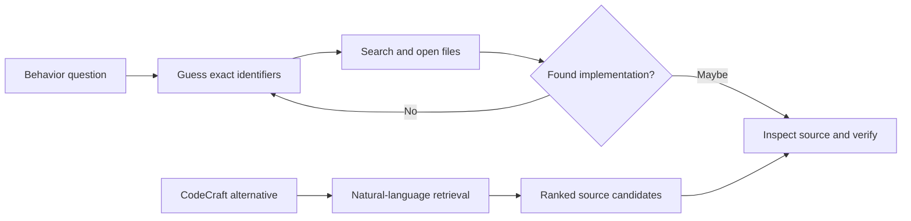

*Figure 1 — The change is the entry point into investigation, not an assertion that verification can be skipped or that a particular amount of time is saved.*

## 2. Requirements and product discovery

CodeCraft was an independently developed project. The repository history includes user-story identifiers and acceptance-test work, but does **not** establish formal client interviews, signed stakeholder requirements, or a commercial discovery process. The tables below combine historically visible requirements with **requirements reconstructed from the shipped implementation**; the latter should not be interpreted as a contemporaneous specification document.

### Functional requirements

| ID | Requirement | Evidence / delivered behavior | Origin |
|---|---|---|---|
| F1 | Ask behavior-oriented questions | Local semantic search returns ranked source regions | Early search work; [PR #10](https://github.com/sultanshahdev/codecraft/pull/10) |
| F2 | Inspect trustworthy source evidence | File paths, line numbers, excerpts; source-view tests | [PR #8](https://github.com/sultanshahdev/codecraft/pull/8) |
| F3 | Express uncertainty | No-supported-candidate and insufficient-evidence outcomes | [PR #5](https://github.com/sultanshahdev/codecraft/pull/5) |
| F4 | Search exact code without model startup | Literal identifier/text search with optional whole-word and case sensitivity | [PR #20](https://github.com/sultanshahdev/codecraft/pull/20) |
| F5 | Investigate GitHub repositories | Prepared GitHub checkouts locally; direct GitHub access in browser mode | [PR #13](https://github.com/sultanshahdev/codecraft/pull/13), [#33](https://github.com/sultanshahdev/codecraft/pull/33) |
| F6 | Explore structure | Files, repository map, declarations and possible usages | [PR #16](https://github.com/sultanshahdev/codecraft/pull/16), [#22](https://github.com/sultanshahdev/codecraft/pull/22), [#24](https://github.com/sultanshahdev/codecraft/pull/24) |
| F7 | Navigate supported definitions | Compiler-backed JS/TS local definition lookup | [PR #26](https://github.com/sultanshahdev/codecraft/pull/26) |
| F8 | Explore more languages | Language registry and Tree-sitter WASM adapters | [PR #28](https://github.com/sultanshahdev/codecraft/pull/28), [#29](https://github.com/sultanshahdev/codecraft/pull/29) |

### Non-functional requirements and constraints

| Concern | Implemented response | Why it matters |
|---|---|---|
| Source privacy | Model inference within the local Node process or visitor's browser | Avoids sending repository contents to a hosted *AI inference* provider; public GitHub retrieval still uses GitHub |
| Resource control | Bounded file count, file size, aggregate bytes, and result counts | Prevents an arbitrary repository from causing unbounded processing |
| Safe inspection | Ignore excluded directories, avoid symlinks, validate paths, do not run repository code | Makes investigation read-only and limits filesystem risks |
| Trustworthiness | Evidence classes, relevance checks, coverage warnings, explicit unsupported/unresolved outcomes | Avoids presenting low-quality ranking as certainty |
| Responsiveness | Cached source embeddings, deferred model loading, separate exact search | Limits repeated work and permits model-independent tasks |
| Reproducibility | Revision-pinned GitHub source and deterministic test fixtures | Keeps links aligned to the analyzed repository version |
| Deployability | Local Node/API/CLI plus browser-native static hosting | Supports local folders and a public web demonstration without hosted Node infrastructure |

**Acceptance criteria examples:** For an exact source query, the highlighted line must correspond to actual repository text; when a file exceeds a configured size limit, processing must skip it and report partial coverage; when a static site responds with fallback HTML at `/api/health`, the app must choose the browser engine; when a definition cannot be resolved, the API must return an honest unresolved/unsupported result. These criteria are anchored to implemented behavior and tests, not invented customer acceptance meetings.

## 3. Scope, MVP, and changing priorities

The core vertical slice was simple to articulate: **prepare a source scope → ask a question → rank candidates → inspect source evidence**. The earliest documented milestones concentrate on validating search readiness, handling uncertain results, and checking that excerpts correspond to actual files. [PR #10](https://github.com/sultanshahdev/codecraft/pull/10) then brought the existing TypeScript CLI and Transformers.js search functionality behind a localhost-only Node API and a React interface.

The scope expanded through evidence-driven additions. Repeated embedding work motivated caching; confusing ranking motivated lexical and intent-aware signals; source results motivated navigation; the need to understand declarations motivated AST analysis; and static deployment motivated a browser-native engine. The end-state architecture should not be retroactively described as the original MVP design.

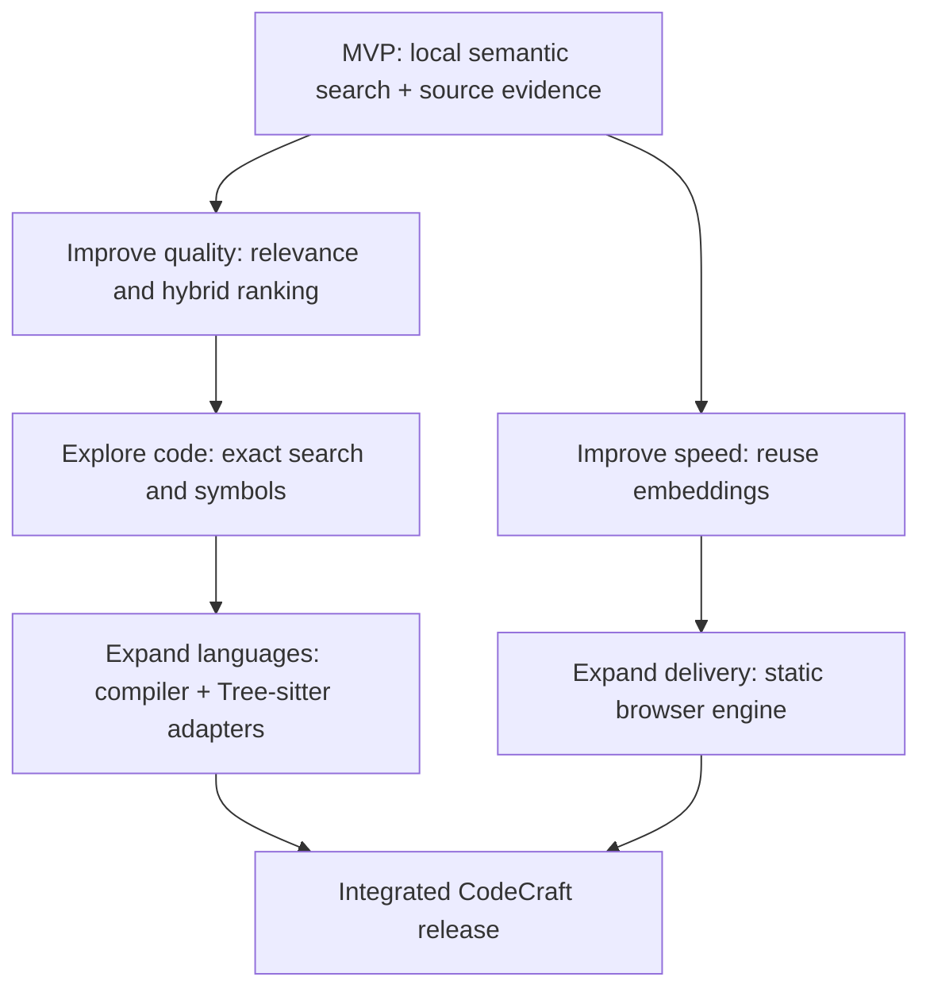

*Figure 2 — A dependency-oriented view of the observed evolution. The arrows indicate capabilities built on earlier work, not a claim that a formal roadmap prescribed every step.*

## 4. Development history: from local search to CodeCraft

The merged pull requests establish an unusually compact but well-documented development sequence. Dates below are merge dates; they are not proof of when an idea was first conceived.

| Date | Phase and engineering outcome | Historical evidence |
|---|---|---|
| **Oct 15** | Search-readiness, honest no-result behavior, ranked candidate/source evidence acceptance checks | [#3](https://github.com/sultanshahdev/codecraft/pull/3), [#5](https://github.com/sultanshahdev/codecraft/pull/5), [#6](https://github.com/sultanshahdev/codecraft/pull/6), [#8](https://github.com/sultanshahdev/codecraft/pull/8) |
| **Oct 15** | Full-stack localhost MVP, embedding reuse, bounded API requests | [#10](https://github.com/sultanshahdev/codecraft/pull/10), [#11](https://github.com/sultanshahdev/codecraft/pull/11), [#12](https://github.com/sultanshahdev/codecraft/pull/12) |
| **Oct 15** | GitHub prepared repositories, intent-aware ranking, repository navigator | [#13](https://github.com/sultanshahdev/codecraft/pull/13), [#14](https://github.com/sultanshahdev/codecraft/pull/14), [#16](https://github.com/sultanshahdev/codecraft/pull/16) |
| **Oct 16** | Disk-backed embedding cache, exact search, AST symbols/usages, Go to Definition | [#18](https://github.com/sultanshahdev/codecraft/pull/18), [#20](https://github.com/sultanshahdev/codecraft/pull/20), [#22](https://github.com/sultanshahdev/codecraft/pull/22), [#24](https://github.com/sultanshahdev/codecraft/pull/24), [#26](https://github.com/sultanshahdev/codecraft/pull/26) |
| **Oct 16** | Pluggable adapters and multilingual WASM source analysis; redesigned product workspace | [#28](https://github.com/sultanshahdev/codecraft/pull/28), [#29](https://github.com/sultanshahdev/codecraft/pull/29), [#30](https://github.com/sultanshahdev/codecraft/pull/30) |
| **Oct 17** | Code Buster-era brand refinements; browser-native execution; production stabilization | [#31](https://github.com/sultanshahdev/codecraft/pull/31), [#32](https://github.com/sultanshahdev/codecraft/pull/32), [#33](https://github.com/sultanshahdev/codecraft/pull/33), [#34](https://github.com/sultanshahdev/codecraft/pull/34) |
| **Oct 24** | Complete CodeCraft rename, compatibility handling, verified production documentation | [#35](https://github.com/sultanshahdev/codecraft/pull/35), [#36](https://github.com/sultanshahdev/codecraft/pull/36) |

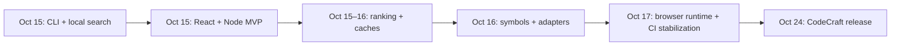

*Figure 3 — Verified release progression. Earlier code-history names were LocalCode Intelligence and Code Buster; current product identity is CodeCraft.*

### 4.1 Search correctness before feature breadth

The early acceptance work separated three concepts often blurred in AI demos: a candidate may exist, it may be semantically similar, and it may be relevant to the requested behavior. [PR #5](https://github.com/sultanshahdev/codecraft/pull/5) introduced explicit low-evidence outcomes. [PR #6](https://github.com/sultanshahdev/codecraft/pull/6) added multi-candidate acceptance tests, while [PR #8](https://github.com/sultanshahdev/codecraft/pull/8) checked source excerpts against repository evidence. These changes show why verification was part of the product model rather than a final polish pass.

### 4.2 Moving retrieval into a usable application

[PR #10](https://github.com/sultanshahdev/codecraft/pull/10) connected the CLI/retrieval engine to a local HTTP API and React/Vite interface. The backend bound to loopback, exposing bounded repository and search operations; the frontend made results inspectable. Later API controls addressed malformed requests, capacity limits, and partial failures. The implemented server currently sets a **64 KiB JSON body limit** and uses a search controller with restricted parallel execution rather than accepting an unbounded stream of inference jobs. [Source: server](https://github.com/sultanshahdev/codecraft/blob/189592c17e4341178f7eb956e173b3dc1a55c78a/src/server.ts).

### 4.3 From useful search to code comprehension

GitHub checkout support and navigation turned isolated snippets into repository context. Exact search was intentionally model-independent. AST declarations, usages, compiler resolution, and multilingual parsers followed in separate PRs. That separation matters: syntax-aware symbol extraction and semantic similarity are different technical problems with different correctness guarantees.

### 4.4 Static hosting forced a second execution model

The public site could not simply call a localhost API running on a visitor's machine. [PR #33](https://github.com/sultanshahdev/codecraft/pull/33) introduced browser-side GitHub preparation and source analysis, keeping the site deployable as static files. [PR #34](https://github.com/sultanshahdev/codecraft/pull/34) addressed runtime detection, browser test races, and the embedding worker's fallback behavior. The browser engine is a deliberately more limited implementation—not an identical relocation of every Node feature.

### 4.5 Controlled naming migration

The final identity change in [PR #35](https://github.com/sultanshahdev/codecraft/pull/35) updated package/CLI names, UI branding, the service health identifier, documentation, and tests. Existing embedding caches were preserved through backward-compatible paths and environment variables. The *same GitHub repository* was renamed in place, keeping history. [PR #36](https://github.com/sultanshahdev/codecraft/pull/36) records the deployment verification and remaining inference-test limitation.

---

## 5. Final system architecture

The React workspace calls an `AnalysisEngine` interface rather than assuming every feature is served by a Node backend. Runtime selection chooses an available, correctly identified local API or loads the browser engine. This permits the same workspace to present repository investigation on both local installations and the static website, though the engines have different implementations and language-analysis depth.

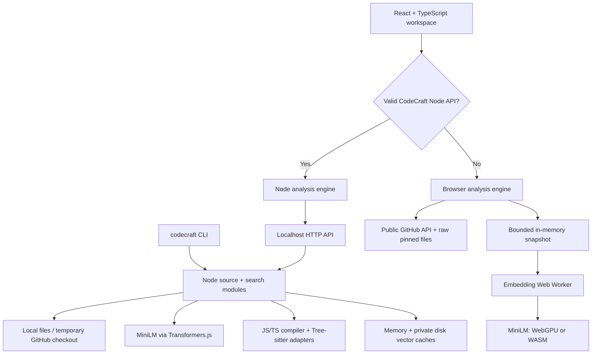

*Figure 4 — Architectural responsibility, not deployment topology: the static Cloudflare site runs the browser engine; it does not have a hosted CodeCraft Node API. [Engine interface](https://github.com/sultanshahdev/codecraft/blob/189592c17e4341178f7eb956e173b3dc1a55c78a/web/src/engine/types.ts).* 

The Node server, source loader, retriever, and language adapters live under `src/`; the React landing and workspace live under `web/`. The CLI reuses Node search functionality. Local GitHub repositories are staged through shallow temporary checkouts with revision verification and guarded cleanup. Browser mode retrieves metadata, a commit SHA, a tree, and bounded raw files using GitHub endpoints directly. The architecture does not require a database, hosted embedding API, or hosted Node service for the static demonstration.

## 6. The AI/ML retrieval pipeline

The **Node engine's hybrid retrieval** is the central algorithmic subsystem. It starts from a bounded set of source regions, not an unbounded clone of the repository. Each region carries a path and line range. `regionEmbeddingText` prefixes source with `File: <path>` so location information contributes to the model input and cache identity. A natural-language query and region texts are embedded with the pretrained, 8-bit-quantized `Xenova/all-MiniLM-L6-v2` model through Transformers.js. The vectors are compared using cosine similarity.

The model is **pretrained**; CodeCraft does not train, fine-tune, or host a generative LLM. Its engineering contribution lies in preparing inputs, executing local inference, caching, hybrid ranking, uncertainty handling, and source navigation.

### 6.1 Node-side retrieval stages

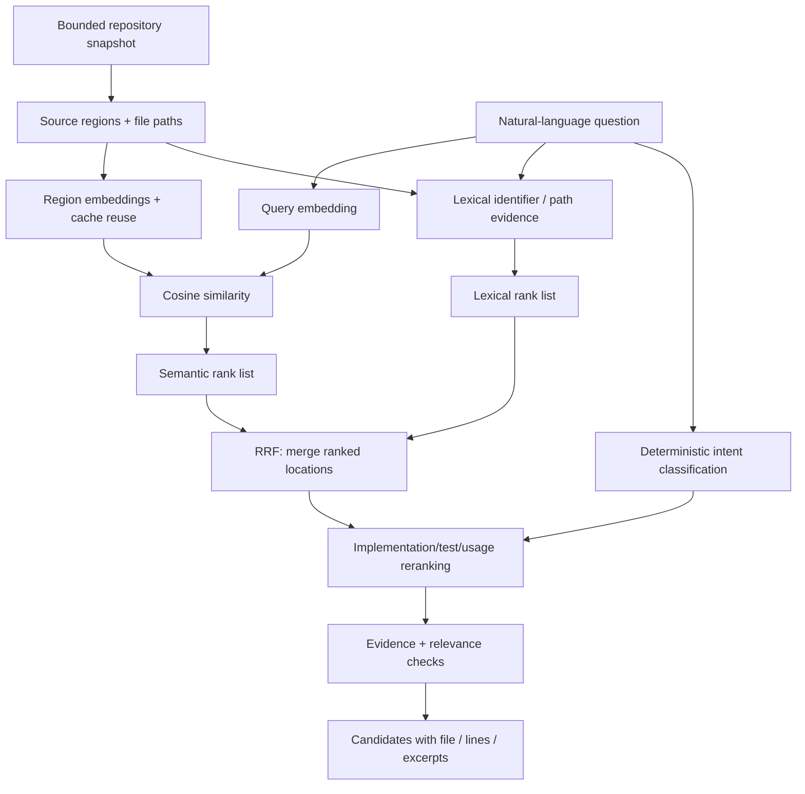

*Figure 5 — The actual Node search path, based on [retrieval.ts](https://github.com/sultanshahdev/codecraft/blob/189592c17e4341178f7eb956e173b3dc1a55c78a/src/retrieval.ts), [search.ts](https://github.com/sultanshahdev/codecraft/blob/189592c17e4341178f7eb956e173b3dc1a55c78a/src/search.ts), and [relevance.ts](https://github.com/sultanshahdev/codecraft/blob/189592c17e4341178f7eb956e173b3dc1a55c78a/src/relevance.ts).* 

**Semantic channel.** The retriever embeds the query and each source region, sorts by cosine similarity, and forms a semantic ranking. Source embeddings may be reused from cache; query embeddings are not persisted to disk. Embeddings are 384-dimensional for the configured model.

**Lexical channel.** A separate pass inspects identifier boundaries, camel-case-like subtokens, full symbol names (including dotted members), paths, and overlapping query terms. It classifies evidence as exact identifier, exact path, strong lexical, partial token, weak overlap, or semantic-only. This prevents a broad semantic resemblance from automatically outranking an exact function declaration.

**Fusion.** The implementation takes the top 50 candidates from each ranking source and groups them by file path plus start/end lines. A candidate's reciprocal-rank contribution is `1 / (60 + rank)` for each list in which it appears. That is a rank-combination signal, **not** a probability or an empirical accuracy score. After fusion, explicit symbol-definition priority and intent compatibility can affect ordering.

**Intent.** A small deterministic classifier distinguishes questions that appear to seek identifiers, tests, examples, usages, implementations, or concepts. It uses query patterns, not another model call. Structural signals such as declarations, control flow, and test/example locations help steer the order. These are heuristics and must remain subordinate to useful query evidence.

**Result handling.** `assessRelevance` combines lexical evidence with recognized code concepts and a limited semantic floor. It can return insufficient-evidence outcomes rather than always displaying a confident-looking top result. The system never proves that a retrieved function enforces the requested behavior.

### 6.2 The ranking rule in code

A short excerpt from [`src/retrieval.ts`](https://github.com/sultanshahdev/codecraft/blob/189592c17e4341178f7eb956e173b3dc1a55c78a/src/retrieval.ts) illustrates the actual rank fusion:

```ts
const score = (current?.score ?? 0) + 1 / (60 + rank);
```

The important decision is **combining ranks instead of treating unlike score scales as interchangeable**. A cosine score and a lexical token-match score have different meanings; rank fusion uses their ordering without pretending they are calibrated probabilities.

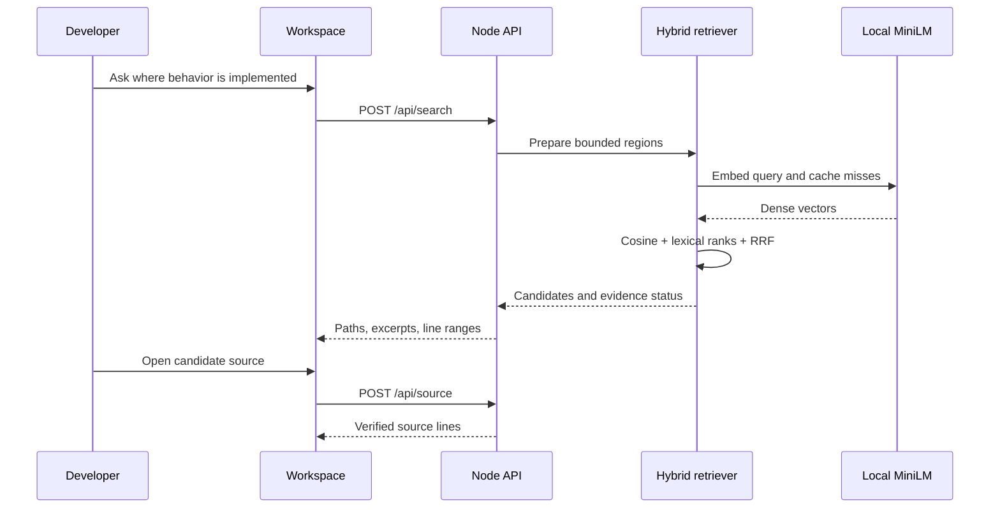

*Figure 6 — A representative Node semantic-search request. Calls are simplified; no hosted LLM is involved.*

### 6.3 Important browser difference

The static browser's semantic path is **not identical to this Node hybrid pipeline**. At the reviewed release, [`browser-engine.ts`](https://github.com/sultanshahdev/codecraft/blob/189592c17e4341178f7eb956e173b3dc1a55c78a/web/src/engine/browser/browser-engine.ts) builds overlapping 40-line chunks, embeds them in batches through a worker, computes vector dot products on normalized vectors, and ranks candidates. Exact search is a separate browser operation. The Node-side lexical fusion, intent reranking, persistent disk cache, and compiler-backed definition behavior should **not** be attributed wholesale to browser mode. That distinction is important both to architectural honesty and to future feature-parity planning.

## 7. Embedding caching: making local inference reusable

Model execution carries a real initialization and CPU/memory cost, especially on first run. CodeCraft addresses repeated region embeddings through two cache layers on Node.

**In-memory layer.** `CachingEmbedder` stores promises keyed by exact embedding input with an LRU capacity of **2,000 entries**. If the same text is requested while its vector is still being computed, callers share the pending promise. A failed embedding request removes the failed entry so subsequent calls can retry rather than inheriting a permanently rejected promise.

**Persistent layer.** `PersistentEmbeddingCache` saves validated source-region vectors under SHA-256-derived filenames using the cache format, model identity, and source embedding text. Records are written to temporary files and renamed into place. Model identity and the expected dimension are checked on reads; invalid/corrupted data is treated as a miss. It evicts old cache records when capacity is exceeded and degrades to model inference if disk operations fail.

**Privacy detail.** Persistent caching explicitly accepts only source-region input positions and checks the `File: ` prefix. **User query vectors are not persisted**. Existing legacy cache locations were preserved during the CodeCraft rename to avoid losing reusable records. [Source: persistent cache](https://github.com/sultanshahdev/codecraft/blob/189592c17e4341178f7eb956e173b3dc1a55c78a/src/persistent-embedding-cache.ts).

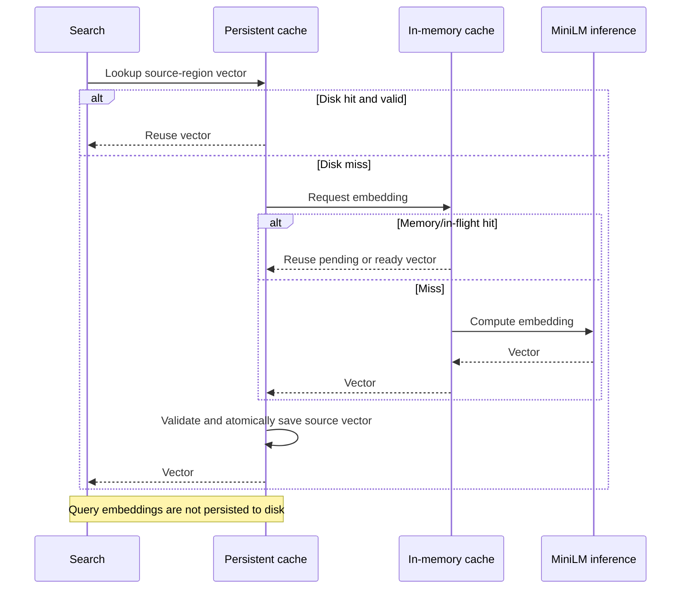

*Figure 7 — Conceptual cache behavior. The implementation's wrapper order is persistent cache around in-memory cache around inference; the sequence shows lookup and fallback responsibilities, not literal method names.*

**Tradeoff:** caching can avoid duplicate work, but correctness depends on invalidation. CodeCraft's cache key includes source text and path, so changed or relocated regions naturally miss. Persistence is model-specific, but storage still requires bounded eviction and safe failure handling. The repository contains tests for cache behavior; it does not establish a universal measured percentage reduction in search latency.

## 8. Bounded source processing and read safety

Unfamiliar repositories are untrusted inputs. CodeCraft therefore enforces limits before attempting to parse or embed everything. The default Node source scope uses **500 eligible files**, **256 KiB maximum for a file**, and **5 MiB aggregate content**, with segmentation windows of **40 lines** and **10 lines of overlap**. Directories such as `.git`, `node_modules`, and generated build outputs are ignored. Source reads exclude symlinks and enforce path boundaries. Processing emits warnings about skipped or truncated data.

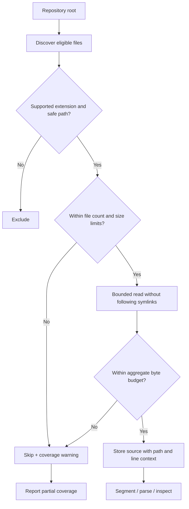

*Figure 8 — Bounded repository preparation; implementation details in [source.ts](https://github.com/sultanshahdev/codecraft/blob/189592c17e4341178f7eb956e173b3dc1a55c78a/src/source.ts).* 

The constraints are intentionally visible to the user. If the snapshot is incomplete, an absent match does **not** mean the repository lacks the requested behavior. This is a useful example of product honesty driven by a systems constraint. Exact search has additional bounds of **256 query characters** and **200 matches**, keeping literal scans controlled without initializing the embedding model. [Source: exact-search.ts](https://github.com/sultanshahdev/codecraft/blob/189592c17e4341178f7eb956e173b3dc1a55c78a/src/exact-search.ts).

## 9. Compiler infrastructure and multilingual code intelligence

Embedding similarity helps find plausible source, but a developer also needs to know where declarations live and how identifiers are used. CodeCraft therefore added a separate structural-analysis subsystem. Early JS/TS symbol extraction used the TypeScript AST; later changes added possible-usage lookup and bounded TypeScript-checker definition resolution. The next architecture step was a `LanguageAdapter` contract and a registry that maps file extensions to language-specific implementations.

The registry distinguishes **basic** operations (search and bounded inspection), **structural** operations (syntax-aware declarations and possible usages), and **precise** operations (reliably resolved definitions). It validates duplicate extensions and prevents adapters from declaring structural or precise capabilities without corresponding methods. That is a more honest contract than a single Boolean flag claiming a language is simply “supported.” [Sources: adapter interface](https://github.com/sultanshahdev/codecraft/blob/189592c17e4341178f7eb956e173b3dc1a55c78a/src/languages/types.ts), [registry](https://github.com/sultanshahdev/codecraft/blob/189592c17e4341178f7eb956e173b3dc1a55c78a/src/languages/registry.ts).

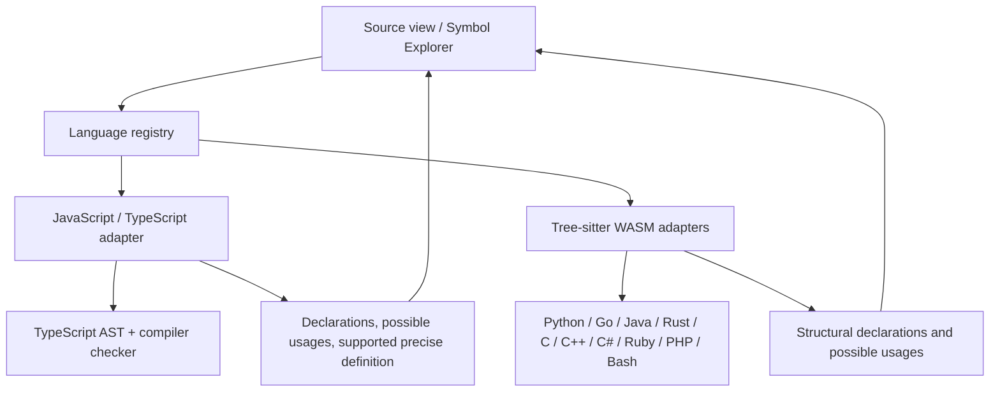

*Figure 9 — Node-side language architecture. Tree-sitter structural support is not the same as compiler-proven cross-file reference resolution. [PR #28](https://github.com/sultanshahdev/codecraft/pull/28), [PR #29](https://github.com/sultanshahdev/codecraft/pull/29).* 

| Languages | Search and inspection | Structural symbols / possible usages | Precise Go to Definition |
|---|---|---|---|
| JavaScript / TypeScript (including JSX/TSX) | Yes | TypeScript compiler analysis in Node | **Supported**, subject to analysis limits |
| Python, Go, Java, Rust | Yes | Tree-sitter WASM in Node | Not implemented |
| C, C++, C#, Ruby, PHP, Bash/Shell | Yes | Tree-sitter WASM in Node | Not implemented |

**Important runtime qualification:** This table describes the **Node language-adapter system**. The static browser engine recognizes multiple source extensions for search and inspection, but its implemented symbol listing is a lightweight JS/TS line-pattern extractor and its definition lookup is a limited loaded-snapshot name match. It does not run the full Node Tree-sitter/TypeScript checker pipeline. [Browser implementation](https://github.com/sultanshahdev/codecraft/blob/189592c17e4341178f7eb956e173b3dc1a55c78a/web/src/engine/browser/browser-engine.ts).

Possible-usage results are **candidate identifier occurrences**; the product deliberately avoids claiming complete type-resolved cross-language references. Supported local JS/TS definition navigation may also report `unresolved`, `ambiguous`, or `unsupported` outcomes instead of manufacturing certainty.

**Tradeoff:** A pluggable parser system is more extensible and precise about capabilities, but increases adapter maintenance, language-specific testing, and consistency work. That tradeoff became visible as CodeCraft grew beyond a single-language search prototype.

## 10. Backend architecture, API, and safety boundaries

The Node backend exposes a localhost-only JSON API for the React workspace and reuses analysis functions accessed by the CLI. Major endpoints include:

| Route | Responsibility |
|---|---|
| `GET /api/health` | Identify a genuine CodeCraft local server |
| `GET /api/languages` | Report language-adapter capabilities |
| `POST /api/repositories/prepare` | Prepare a local directory or GitHub repository |
| `POST /api/repo/status` | Show eligibility and processing scope |
| `POST /api/search` | Run Node hybrid semantic retrieval |
| `POST /api/search/exact` | Model-independent literal lookup |
| `POST /api/repositories/files` and `/api/repository/map` | Explore paths and hierarchy |
| `POST /api/symbols`, `/api/symbols/usages`, `/api/symbols/definition` | Structural navigation |
| `POST /api/source` | Read bounded source lines |

All routes above are described in the [project README](https://github.com/sultanshahdev/codecraft/blob/189592c17e4341178f7eb956e173b3dc1a55c78a/README.md). The server binds to `127.0.0.1` by default and uses JSON content-type checks, bounded request bodies, and origin restrictions. Repository input is inspected rather than executed. GitHub preparation uses a **shallow, no-submodules checkout** staged under an application-managed temporary location; the acquired revision is checked before it becomes an active prepared source. A failed refresh does not destroy the previously prepared checkout. [Source: GitHub acquisition](https://github.com/sultanshahdev/codecraft/blob/189592c17e4341178f7eb956e173b3dc1a55c78a/src/github-repository.ts).

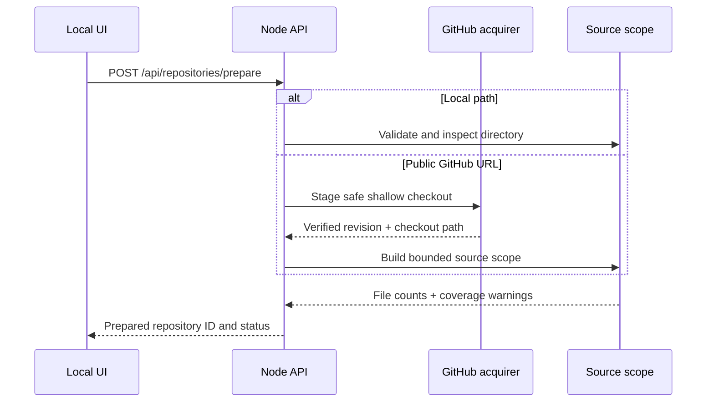

*Figure 10 — Representative repository preparation. A prepared repository ID is used for subsequent operations instead of trusting arbitrary paths from the browser.*

These protections should not be misrepresented as a public, multi-tenant security design. The localhost server assumes a trusted local user. Exposing it on the public internet would require a separate authentication, authorization, isolation, and abuse-control architecture.

## 11. Why two runtimes were necessary

Static hosting and local filesystem inspection have incompatible execution constraints. A deployed Cloudflare Pages website cannot read a visitor's local source folder by invoking its own `/api` endpoint; no Node server is present there. The public experience therefore needs browser-native repository analysis, while local folders remain available through the installed Node application.

The React workspace resolves an `AnalysisEngine` by probing `/api/health` for a **successful JSON response with `service: "codecraft"`**. This matters because a static single-page app may return its HTML shell for an unknown path with HTTP 200. A status-code-only health check would falsely infer a local backend and break the static workspace. [Source: detect-runtime.ts](https://github.com/sultanshahdev/codecraft/blob/189592c17e4341178f7eb956e173b3dc1a55c78a/web/src/engine/detect-runtime.ts).

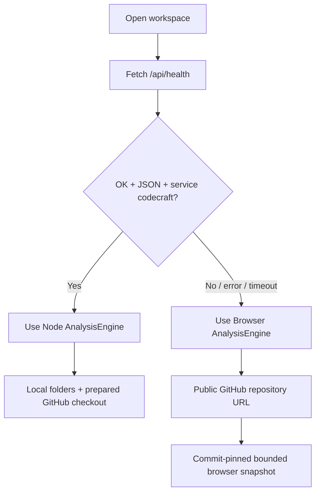

*Figure 11 — Runtime detection validates **content and service identity**, not merely HTTP success. This behavior was critical to production stabilization.*

### Browser-side repository preparation

Browser mode validates a canonical HTTPS GitHub repository URL, resolves the default branch and commit SHA, retrieves the pinned tree, filters eligible files, and downloads only bounded source files. Concurrent downloads have a limit of six; a deterministic file-order pass applies the aggregate byte budget after downloads, avoiding dependency on network completion order. The resulting snapshot stays in browser memory for investigation. For source inspection and exact search, no ML model is required. [Source: browser-engine.ts](https://github.com/sultanshahdev/codecraft/blob/189592c17e4341178f7eb956e173b3dc1a55c78a/web/src/engine/browser/browser-engine.ts).

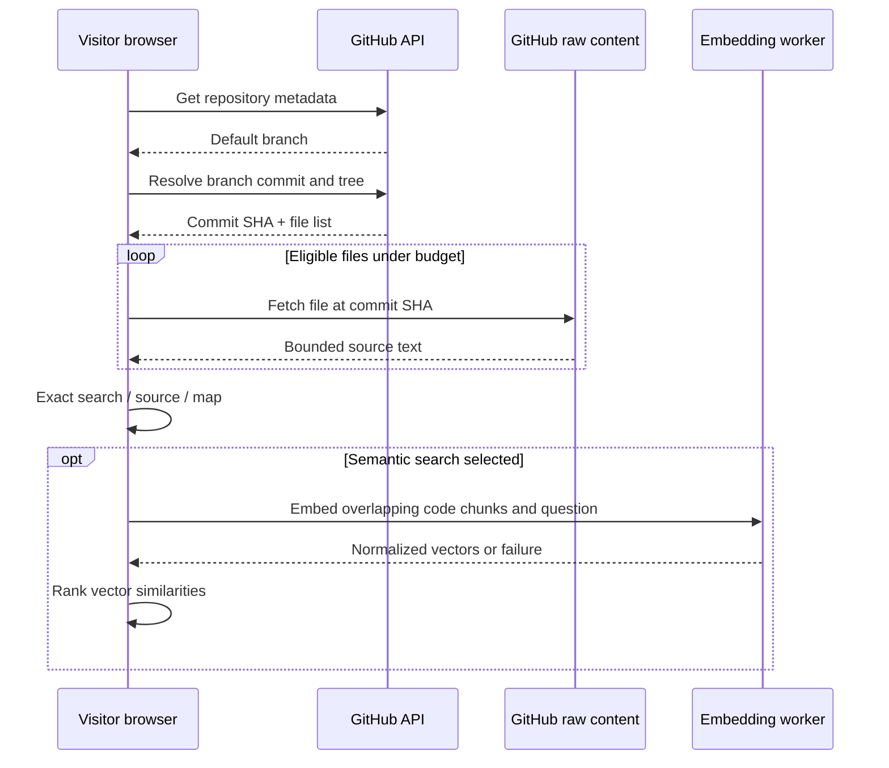

*Figure 12 — Browser-native execution calls GitHub, but **does not** require a hosted CodeCraft API or send source code to an external AI inference service. The model itself may need to be downloaded when first used.*

### Browser inference and fallback

The embedding worker loads the quantized `Xenova/all-MiniLM-L6-v2` feature-extraction pipeline lazily. Where `navigator.gpu` is available, it attempts WebGPU; on initialization failure, it falls back to WASM. It reports errors to the UI rather than silently claiming no relevant code was found. The browser engine has a **90-second semantic worker timeout**, after which exact search remains available. [Source: embedding-worker.ts](https://github.com/sultanshahdev/codecraft/blob/189592c17e4341178f7eb956e173b3dc1a55c78a/web/src/engine/browser/embedding-worker.ts).

This is an architectural capability backed by code and deterministic browser tests. **It is not the same as an end-to-end successful live semantic browser inference test:** the recorded release environment timed out during that optional live check. That limitation is documented in the release notes rather than hidden.

## 12. The user experience: investigation rather than chatbot output

The intended journey begins with a concrete source scope, not a blank conversation. Developers prepare a local or public repository, enter a behavior-oriented question or an exact identifier, compare results, then open source lines. The file explorer, repository map, Symbol Explorer, and definition actions help turn an isolated candidate into a broader investigation.

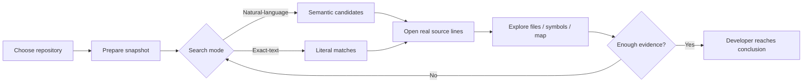

*Figure 13 — A user journey designed around evidence review. The application presents candidates; the developer makes the final behavioral judgment.*

The React/Vite frontend separates a marketing landing page from the working repository interface. Historically, a significant redesign followed the initial functional MVP in [PR #30](https://github.com/sultanshahdev/codecraft/pull/30), with later wordmark, mascot, and investigation-story refinements in [#31](https://github.com/sultanshahdev/codecraft/pull/31) and [#32](https://github.com/sultanshahdev/codecraft/pull/32). The final product uses a dark graphite palette, off-white editorial headings, restrained coral/lavender accents, and a ghost mark. These decisions create a recognizable identity, but the case study's design argument is more practical: keep repository context and source evidence reachable, and disclose limitations where they affect judgment.

### Screenshot plan for the portfolio page

The following are **capture instructions**, not fabricated screenshots:

| Placement | Capture from real application | What the caption should establish |
|---|---|---|
| Hero (16:9) | Final CodeCraft homepage hero and wordmark | Finished product identity and problem framing |
| Repository setup (16:9) | Public GitHub repository input and preparation state | How a developer establishes a source scope |
| Search (16:9) | Real repository, real query, visible ranked candidates | Behavioral retrieval produces inspectable source locations |
| Inspector (16:9) | Real source file with lines, path, and selected candidate | Ranking is verified by source inspection |
| Explorer / map (16:9) | Repository file tree or map | Navigating surrounding code |
| Structural navigation (16:9) | Symbol declaration and a supported definition result | Distinct compiler-backed or structural capability |

Use actual data and annotate *illustrative demo* examples as such. Recommended image alt text should identify the screen, the repository-related information shown, and the interaction being demonstrated. Avoid adding synthetic “accuracy” numbers or fake result scores to an image.

## 13. Engineering problems encountered and resolved

The merged PRs and tests show that CodeCraft was not a straight-line build. Several of its strongest lessons come from reliability work.

| Problem | Investigation and change | Verification and meaning |
|---|---|---|
| Search could suggest weak matches | Introduced evidence-aware no-result and relevance decisions | [PR #5](https://github.com/sultanshahdev/codecraft/pull/5); ranking is not mistaken for proof |
| Exact source evidence needed validation | Added acceptance test comparing shown excerpt to fixture source | [PR #8](https://github.com/sultanshahdev/codecraft/pull/8); preserves result traceability |
| Repeated unchanged embeddings | Shared in-flight in-memory LRU vectors, then persisted source-region vectors | [PR #11](https://github.com/sultanshahdev/codecraft/pull/11), [#18](https://github.com/sultanshahdev/codecraft/pull/18); reduces repeated work without invented speedup claims |
| Model relevance and exact implementation clues disagreed | Combined lexical evidence and semantic ranks; added intent-aware reranking | [PR #14](https://github.com/sultanshahdev/codecraft/pull/14) and current `retrieval.ts` |
| Repository operations could consume uncontrolled resources | Enforced file/byte/result limits, bounded request bodies, execution capacity | [PR #12](https://github.com/sultanshahdev/codecraft/pull/12); predictable failures and warnings |
| Multilingual symbols needed different parsers | Added capability-aware language adapters and Tree-sitter WASM | [PR #28](https://github.com/sultanshahdev/codecraft/pull/28), [#29](https://github.com/sultanshahdev/codecraft/pull/29) |
| Static hosting spoofed backend health | Required `codecraft` JSON health shape, not simply HTTP 200 | [PR #34](https://github.com/sultanshahdev/codecraft/pull/34) and runtime test |
| Browser smoke checks were timing-sensitive | Replaced immediate observations with event/readiness-aware waits | [PR #34](https://github.com/sultanshahdev/codecraft/pull/34); passing GitHub Actions browser-smoke |
| Browser model availability varied | Used WebGPU-first initialization with WASM fallback and explicit worker failure handling | Implemented fallback; live inference still had a recorded validation gap |
| Product rename risked breaking caches and links | Updated service, packages, CLI, assets, tests, and GitHub in place; retained compatible cache locations | [PR #35](https://github.com/sultanshahdev/codecraft/pull/35), [#36](https://github.com/sultanshahdev/codecraft/pull/36) |

A notable debugging example occurred in browser smoke testing. Local tests initially passed while GitHub Actions exposed asynchronous request-observation races. The appropriate fix was to wait for the actual observable condition, not to insert arbitrary sleeps or delete an assertion. This distinction—**test synchronization rather than test relaxation**—is a meaningful part of engineering reliability.

Another example was the Hugging Face model download during release validation. Standard retrieval timed out in the development environment; the recorded run recovered the unchanged model artifact through an alternate CDN resolution and checked its SHA-256 before running real inference. This supports the **Node model test result**, not an assertion that model download behavior is reliable on every client network.

## 14. Testing and verification strategy

CodeCraft uses more than visual demonstration as proof of functionality. Its tests cover core search behavior, resource and source boundaries, API behavior, parser and symbol navigation, and browser interactions. Deterministic fixtures isolate expected retrieval evidence from unpredictable external repositories. Browser smoke checks exercise navigation and runtime selection without depending on a live model download for every CI run.

| Layer | What it guards | Evidence |
|---|---|---|
| Unit / deterministic | Retrieval, lexical matching, relevance outcomes, caches, input validation | `test/` and Node test runner |
| Acceptance | Multiple candidates and correct source snippets | [PR #6](https://github.com/sultanshahdev/codecraft/pull/6), [#8](https://github.com/sultanshahdev/codecraft/pull/8) |
| Integration | API calls, supported code analysis, repository source rules | Backend test suite |
| Browser smoke | React flows, mocked API, static browser-native GitHub preparation | `scripts/browser-smoke.mjs`, `scripts/browser-native-smoke.mjs` |
| Actual model | Node MiniLM model initialization/inference and CLI semantic search | Recorded October 24 release run |
| Deployment checks | `/app` refresh, branding, GitHub preparation, exact search, source and map | [Release documentation](https://github.com/sultanshahdev/codecraft/blob/fc9b57a8c06ca6bf3569fd728234cd84acf19e44/docs/codecraft-migration.md) |

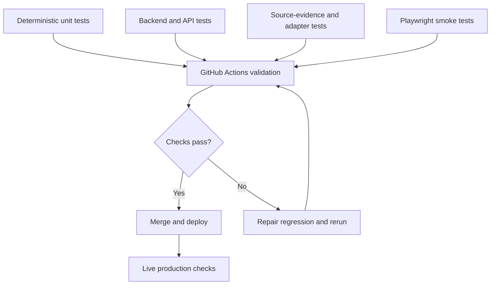

*Figure 14 — Verification layers, separated from manual release checks. The CI workflow has two primary jobs: build-and-test and browser-smoke.*

**Recorded release outcome, October 24, 2026:** 106 passing tests, one existing deferred acceptance skip, clean frontend/backend build, passing deterministic browser smoke scripts, and a real local MiniLM inference check. The exact percentage of statements or branches covered is **not established** by these counts. The optional live browser-native semantic test timed out, and the case study must not present that path as proven end-to-end. [Release verification](https://github.com/sultanshahdev/codecraft/blob/fc9b57a8c06ca6bf3569fd728234cd84acf19e44/docs/codecraft-migration.md).

## 15. CI/CD and deployment

The repository's `.github/workflows/ci.yml` configures two parallel checks on pull requests and pushes to `main`. The **build-and-test** job installs backend/frontend dependencies, builds, installs Chromium, and runs deterministic tests. The **browser-smoke** job builds the web application and runs both the mocked-API and static browser-native smoke scripts. Both use Node 22 and npm dependency locks; the backend CI installation sets `ONNXRUNTIME_NODE_INSTALL_CUDA=skip` to avoid optional GPU installation overhead where it is not needed. [CI workflow source](https://github.com/sultanshahdev/codecraft/blob/fc9b57a8c06ca6bf3569fd728234cd84acf19e44/.github/workflows/ci.yml).

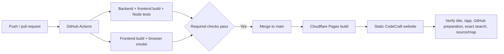

*Figure 15 — The verified release pipeline. Live verification is a separate step and should not be misrepresented as automatically guaranteed by CI.*

The static deployment is configured from the `web` directory using `npm run build` with `dist` as output. A visitor loads the React site from Cloudflare and, when no valid local Node API responds, uses browser-side GitHub access and analysis. The existing production hostname is **`https://code-buster-f5d.pages.dev`** because the Cloudflare project was preserved during the CodeCraft rename. The live UI and metadata were verified as CodeCraft in the release log. The historical hostname is an external infrastructure identifier, not the current product identity.

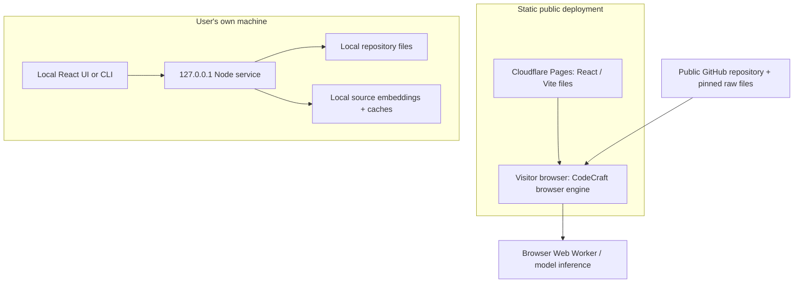

*Figure 16 — Actual hosting topology. The cloud site is static; a user's localhost Node service is not hosted on Cloudflare and is not publicly exposed.*

After the GitHub repository rename, a subsequent documentation branch successfully rebuilt in the existing Cloudflare Pages project, showing that the connected deployment continued operating. [PR #36](https://github.com/sultanshahdev/codecraft/pull/36) merged on October 24, 2026. This case study uses the documented release verification; it does not assert that a new browser run was performed while writing the article.

## 16. Delivered results and measured scope

The final application lets developers search code by behavioral intent, inspect ranked source candidates, search literal identifiers without starting a model, examine repository files and maps, find structural declarations, and follow supported symbol navigation. Node mode can inspect local directories or prepared public GitHub checkouts. Static browser mode supports public GitHub inspection with a different, lighter analysis implementation.

The available metrics establish **implementation scope and test evidence**, rather than business impact:

- **12 languages** recognized through Node-side adapters for search/structural inspection, with different precise-navigation capabilities.
- **384 dimensions** per MiniLM embedding; this states the representation, not model accuracy.
- **500 files**, **256 KiB per file**, and **5 MiB total** as protective source-snapshot limits, not benchmark throughput.
- **2,000 in-memory cache entries** as a configured LRU bound, not a measured cache hit rate.
- **106 passing tests** in a specific verified local release run, not “106% coverage” or adoption evidence.

No measured p95 latency, retrieval precision/recall, customer count, savings, or accuracy uplift is established by the reviewed evidence. Those would require dedicated benchmark methodology and data.

## 17. Architectural tradeoffs

| Decision | Benefit | Cost / boundary |
|---|---|---|
| Pretrained quantized MiniLM | Makes practical local sentence-vector inference possible without a hosted AI API | First-run download, model fit limitations, device-dependent performance |
| Hybrid Node retrieval | Uses both semantic relatedness and explicit source clues | More heuristic paths and ranking regressions to test |
| Evidence-first result UI | Lets users inspect what was actually retrieved | Does not automate semantic proof of behavior |
| LRU + disk vector caches | Reuses unchanged source inference and in-flight work | Key design, invalidation, eviction, and storage safety |
| Bounded source snapshots | Predictable work and safer scanning | Partial coverage can hide relevant implementations |
| TypeScript checker + Tree-sitter | Appropriate parsing/resolution by language | Language support levels differ; not full cross-language resolution |
| Shared AnalysisEngine interface | One UI can target Node and browser contexts | Risk of assuming feature parity across backends |
| Cloudflare static hosting | No permanently hosted Node API required for the public demo | Browser cannot read arbitrary local folders or guarantee ML backend support |
| Exact search separate from embeddings | Useful even before model initialization or on ML failures | Does not solve vocabulary mismatch for behavior queries |

These are architectural tradeoffs derived from the implementation. Where the project history does not explicitly document a particular thought process, they are **technical interpretations**, not verbatim statements of the author's original intentions.

## 18. Known limitations and honest failure modes

CodeCraft is a **source investigation tool, not a static proof system**. Top-ranked results may be irrelevant; regions might be omitted because of source budgets; a symbol match may indicate only a possible usage rather than a bound reference; and compiler-backed precise definition resolution is constrained to supported JS/TS contexts in Node mode. Browser-mode source intelligence is less capable than the Node adapter pipeline.

The application does not execute arbitrary repository code to discover runtime behavior. It does not provide multi-user hosted backend services, access to private GitHub repositories through the static anonymous browser workflow, or automatic local-folder inspection in the deployed website. Model downloads can require network connectivity, and browser inference is sensitive to browser capabilities and model availability. In the October 24 release verification, **Node inference passed, while live browser semantic inference did not receive a successful end-to-end confirmation**.

These boundaries are deliberate engineering information: they tell a user what evidence the product actually has and where independent inspection remains necessary.

## 19. What I learned from engineering it

**Search quality is a systems problem, not just a model-choice problem.** A similarity vector by itself is insufficient when a user expects to find an actual implementation. Lexical clues, location, intent, explicit uncertainty, and source navigation matter as much as a fluent prompt.

**Local ML needs ordinary software engineering discipline.** Cache invalidation, failed promises, corrupt disk records, model downloads, worker timeouts, and processing budgets determine whether a developer can use a model repeatedly and safely.

**Compiler analysis requires careful claims.** “Symbol exists,” “possible usage,” and “resolved definition” are not interchangeable results. Modeling those capability levels in a registry is more credible than applying one vague “supported” label to every language.

**Static and local deployment are different products at the systems boundary.** Sharing a React UI is possible; sharing identical backend behavior is not automatic. A valid health contract and explicit feature differences are necessary for correct runtime selection.

**Reliable tests must wait for the condition they care about.** GitHub Actions exposed races that local smoke runs missed. Replacing fragile immediate assertions with observable readiness checks was a better resolution than weakening the tests.

These reflections summarize engineering evidence from the code and change history rather than asserting unrecorded personal experiences or external feedback.

## 20. Potential next experiments

The most valuable future work would improve **verification and evaluation**, rather than add another broad feature category:

1. Build a versioned benchmark of real behavior questions with independently labeled source locations, then measure retrieval precision and recall.
2. Measure cold-start and warm-cache search latency on defined repository sizes and hardware profiles; report percentiles rather than single anecdotal runs.
3. Add reliable browser inference coverage across WebGPU-enabled and WASM-only environments, while preserving clear fallback messages.
4. Consider incremental indexing for repositories larger than current source budgets, with explicit invalidation rules.
5. Expand precise symbol resolution by language only where a real language-service or compiler integration can support it.
6. Tighten cross-runtime capability reporting so users understand when a browser result is approximate and a local Node result is compiler-backed.

These are **proposed improvements**, not implemented features or promises of a dated roadmap.

## 21. Closing reflection

CodeCraft began as a focused attempt to make unfamiliar source code searchable by behavior. Its strongest engineering work grew around that initial idea: evaluating uncertain retrieval, fusing semantic and lexical evidence, caching local embeddings, enforcing safe resource limits, adding compiler-based navigation, and supporting two execution environments without turning a static demo into a hosted inference service.

The finished project demonstrates a complete software-engineering cycle: a real developer-workflow problem, a working vertical slice, expanding requirements, deliberate architecture boundaries, debugged failures, deterministic tests, CI, deployment, and a traceable release history. The main lesson is simple: **a useful AI engineering tool is defined not only by the model it runs, but by the evidence it returns and the reliability of the surrounding system.**

**[Explore the source on GitHub](https://github.com/sultanshahdev/codecraft)** · **[Try the live CodeCraft site](https://code-buster-f5d.pages.dev)**

---

## Evidence and editorial notes

**Source baseline:** Current CodeCraft repository and merged development PRs, with source-code links pinned primarily to the October 24 rebrand merge [`189592c`](https://github.com/sultanshahdev/codecraft/commit/189592c17e4341178f7eb956e173b3dc1a55c78a) and release documentation pinned to the PR #36 merge [`fc9b57a`](https://github.com/sultanshahdev/codecraft/commit/fc9b57a8c06ca6bf3569fd728234cd84acf19e44).

**Evidence hierarchy:** (1) compiled source and source-controlled tests; (2) merged PRs, descriptions, workflow and release records; (3) project conversation history; (4) labeled architectural inference. Reconstructed requirements and illustrative user questions are not claims of formal client interviews or observed customers. Source-grounding and language capabilities must be reviewed again if the published site is updated after this source baseline.

**Publishing checklist:** Add genuine application screenshots; verify each Mermaid block renders in the site's Markdown/MDX pipeline; ensure diagrams have accessible descriptions; check link targets; use a responsive table wrapper; and distinguish marketing illustration from actual search output. The author should not use fabricated screenshots, user statistics, or performance benchmarks.
