# SOAR Lite

## Building a security incident response automation platform

> **Project type:** Cybersecurity / security automation · **Role:** Independent developer · **Period:** October 2026 · **Status:** Functional local-first MVP, manually demonstrated end to end
>
> **Stack:** Python, FastAPI, Pydantic, PostgreSQL, SQLAlchemy, Alembic, React, TypeScript, Vite, Tailwind CSS, HTTPX, AbuseIPDB API v2, Docker Compose
>
> **Architecture:** Modular monolith; separately running API and worker; shared PostgreSQL · **Repository:** [SOAR Lite on GitHub](https://github.com/sultanshahdev/soar-lite) · [Full source architecture](https://github.com/sultanshahdev/soar-lite/blob/main/architecture.md)

**In one sentence:** I built a local security-operations workbench that accepts suspicious-login alerts, automatically researches their source IPs, and lets an analyst authorize, inspect, and reverse a **simulated** response.

**Featured visual:** [REAL SCREENSHOT REQUIRED — SOC Overview; see asset plan](SOAR_LITE_CASE_STUDY_ASSETS.md). Do not use the conceptual LinkedIn illustration as a substitute for a real application screenshot.

### At a glance

| The question | What I built |
| --- | --- |
| **Problem** | Reviewing a suspicious-login alert can require repeated reputation checks, decisions, and recordkeeping. |
| **Approach** | Automate ingestion and evidence gathering; retain human authorization for containment. |
| **Engineering focus** | Durable PostgreSQL workflows, concurrency-safe worker claims, bounded recovery, transaction integrity, authorization gates, and auditability. |
| **Evidence of completion** | A user-reported eight-stage live walkthrough covered authenticated alert ingestion through real AbuseIPDB evidence, approved simulated containment, and reversal. |
| **Safety boundary** | Containment changes only PostgreSQL lab entries. No host firewall, cloud policy, network traffic, or real service is blocked. |

## 1. Executive summary

Security teams receive signals from other monitoring systems. An alert by itself does not say whether activity is dangerous, what evidence supports that conclusion, or whether a response is justified. An analyst needs to gather context, decide what action is appropriate, and preserve a record of the decision. Automating the repetitive parts is useful; automatically disrupting legitimate traffic can be harmful.

I built **SOAR Lite** to explore that boundary in a small, working system. It authenticates a generic alert webhook, checks and stores incoming events, and creates an incident. For the supported `suspicious_login` event with a globally routable source IP, it adds a durable investigation. A separate worker checks that IP with AbuseIPDB and saves normalized evidence, which appears in the React analyst dashboard. An analyst can then propose and approve a `block_ip` action. A second worker applies the **simulated** block, recording state transitions and audit events. The analyst can later reverse the specific action without removing another action's active block for the same IP.

The implementation goes beyond a dashboard. PostgreSQL uniqueness constraints prevent duplicate logical ingestion; worker claims use row locking, leases, token checks, and retries to handle competition and failure. API and worker processes share a small set of domain models without bringing in a separate broker. The full alert-to-reversal journey was manually checked in the running local stack. Automated tests cover important individual behaviors and an acceptance path with a mocked AbuseIPDB provider; their most recent full-suite result must not be overstated.

## 2. The problem: one alert, many decisions

Imagine a monitoring system reports repeated failed login attempts against a company server. That signal could deserve investigation, but it could also be a harmless or misunderstood event. Traditionally an analyst might open the alert, identify its source IP, consult a reputation service, record the findings, decide whether to contain the source, and document the result. If an action was mistaken, someone must know how to undo it. When each step lives in a different tool, the sequence is harder to reconstruct.

SOAR Lite does not claim to solve all security operations. It addresses one testable part: **moving an externally generated suspicious-login alert through a consistent investigation-and-decision process**. It is not a network sensor, intrusion detection engine, SIEM, or firewall. Those omissions matter: the system was designed to exercise orchestration and response-control engineering, not to pretend to replace monitoring infrastructure.

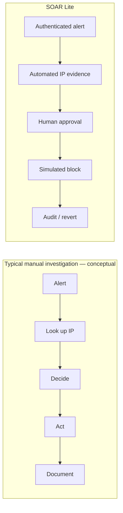

**Design thesis:** automation should shorten the distance from signal to evidence, not remove a person's responsibility for a potentially disruptive response. A high reputation score is context, not proof of malicious intent. A synthetic alert used during a demo is not proof of an attack.

## 3. Requirements gathering: developer-led, not a fictional customer brief

This was an independent, developer-defined MVP. There is no evidence of formal stakeholder interviews, customer adoption, a production SOC rollout, or measured enterprise pain points. I translated a realistic security-operations scenario into functional requirements and a narrow definition of done. The original development target was an intensive **two-day MVP sprint**; that target should not be mistaken for a verified time-to-delivery measurement.

### Functional requirements and traceability

| ID | Requirement / reason | Implementation | Evidence / verification |
| --- | --- | --- | --- |
| FR-01 | Authenticate security alerts before ingestion | Webhook bearer credential | `backend/app/security/auth.py`, alert API tests |
| FR-02 | Reject malformed alert data | Pydantic schema, content-type and declared-length checks | `backend/app/domain/alerts/schemas.py`, `backend/app/api/alerts.py` |
| FR-03 | Avoid duplicate deliveries creating repeated work | Unique `(source, source_event_id)` and duplicate-return path | `backend/app/domain/alerts/service.py`; acceptance test |
| FR-04 | Preserve alerts and incidents | SQLAlchemy models / PostgreSQL transaction | `backend/app/persistence/models.py` |
| FR-05 | Investigate supported suspicious logins | Queue `suspicious_ip` for global source IP | `backend/app/domain/alerts/service.py` |
| FR-06 | Use actual reputation intelligence | HTTPS AbuseIPDB v2 connector | `backend/app/connectors/abuseipdb.py`; live walkthrough |
| FR-07 | Keep findings inspectable | JSONB investigation evidence | `InvestigationEvidence` model, investigation read API |
| FR-08 | Track investigation progress | Queued/running/completed/failed persistence | `backend/app/workers/investigations.py` |
| FR-09 | Restrict analyst actions | Separate `X-API-Key` gate | `backend/app/security/auth.py` |
| FR-10 | Require an explicit containment decision | Proposal, approve, reject endpoints | `backend/app/api/responses.py` |
| FR-11 | Execute only approved simulated responses | Response worker + `LabResponseAdapter` | `backend/app/workers/responses.py` |
| FR-12 | Preserve response history | `ResponseAuditEvent` records | Responses API, acceptance test |
| FR-13 | Support selective reversal | Revert API deactivates action-owned entry | Lab response adapter, tests, live walkthrough |
| FR-14 | Let analysts follow the journey | React Overview, Incidents, Investigations, Responses, Blocklist | `frontend/src/App.tsx` |
| FR-15 | Run on a developer's machine | Four-service Docker Compose stack | `infra/compose.yaml`, local walkthrough |

### Nonfunctional requirements

**Safety.** The response adapter must not execute a shell command or alter network infrastructure. This is not a convenience claim but a core containment boundary. **Consistency.** Critical writes and decisions should be atomic so the database never represents a partial logical action as completed. **Recoverability.** Workers must be able to handle timeouts, failed provider calls, and abandoned claims. **Concurrency.** Competing workers must not process the same available row simultaneously. **Security.** Separate credentials protect ingestion and analyst APIs, with private values kept out of frontend bundles. **Reproducibility.** Setup, startup, schema migrations, and synthetic alert submission should work from documented commands. **Maintainability.** Modules should remain understandable enough to test and change independently.

These requirements drove technology choices. A single PostgreSQL database serves both record storage and job state; workers coordinate through transactions rather than in-memory flags. The API uses explicit credentials, and the frontend deliberately does not receive the webhook or AbuseIPDB secrets.

### Constraints, scope, and acceptance criteria

The key constraint was to finish **one believable vertical slice**, not a broad security suite. I excluded real Wazuh/Suricata integrations, packet inspection, autonomous blocking, enterprise RBAC, multi-tenancy, generalized YAML playbook execution, distributed brokers, and Kubernetes. A feature appearing in an early wish list is not evidence that it shipped. These exclusions reduced deployment cost, debugging surface, and the risk of accidental real-world containment.

The core acceptance condition was concrete: a valid security alert must reach a stored incident; a supported IP must be investigated; evidence must be visible; a human must approve before response execution; a simulated block and audit trail must be persisted; and reversal must deactivate only the associated block. This is a stronger success definition than simply proving that all four containers start.

## 4. Planning the engineering work

The work followed small milestones in which each layer created a usable foundation for the next. The historical `context.md` records intermediate failures, partial verification, and follow-up fixes, so the sequence below reflects development evidence rather than an invented ideal process.

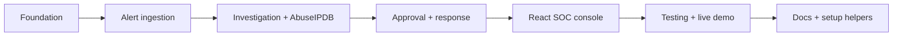

| Phase | Goal and outcome | Most important difficulty / check |
| --- | --- | --- |
| **1 — Foundation** | FastAPI health route, Vite shell, PostgreSQL, Alembic, Compose, CI scaffold | TestClient compatibility (`httpx2`) and isolated migration setup |
| **2 — Ingestion** | Authenticated generic webhook, typed input, incidents, duplicate handling, analyst read APIs | Stable event identity and transactional ingestion |
| **3 — Investigation** | Evidence model, async AbuseIPDB connector, queue, leased worker, retries | Expired claims and competition across independent DB sessions; a historical PostgreSQL suite reached **24 passed, 0 skipped** for the then-current scope |
| **4 — Response** | Proposals, approval/rejection, audit, response worker, simulated block and revert | Replayed decisions, action ownership, stale execution, safe reversal |
| **5 — Analyst console** | Overview, Incident/Investigation explorers, evidence, decisions, blocklist | Typed API calls, in-memory analyst key, client/server integration |
| **6 — Verification** | Real-PostgreSQL acceptance path, disposable schema isolation, live eight-stage walkthrough | Shared database state leaked between integration tests until fixture cleanup was added |
| **7 — Delivery** | README, root architecture guide, setup/start/demo scripts | New-user reproducibility without leaking credentials or adding infrastructure |

The milestones were not feature flags in a production rollout. They were successive local implementation and verification steps. I used code review, focused tests, migration checks, and finally a browser walkthrough to move from independent components to a complete workflow.

## 5. Architecture: one database, two backend processes

SOAR Lite is a **modular monolith**. API routes, domain logic, persistence, connectors, and worker code are separated into Python modules, but they belong to one backend codebase. FastAPI runs as an API process; a second Python process runs the investigation and response processors. Both share SQLAlchemy models and PostgreSQL. React runs as a separate frontend. This design deliberately avoids the setup overhead of a message broker or independently deployed services.

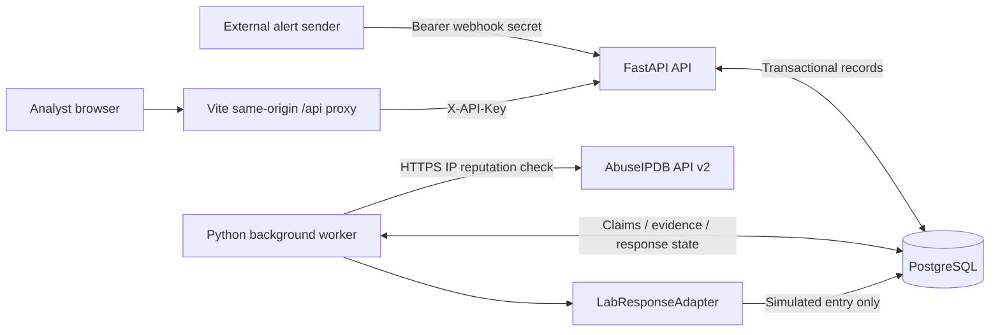

The data boundary is important. The frontend never calls AbuseIPDB directly and does not receive the webhook or provider credential. The worker commits an investigation claim before issuing an external HTTP request, rather than holding a row lock while waiting on the provider. The response adapter is not a network-control adapter; it writes a row in PostgreSQL.

| Component | Input → output | Why it exists / source |
| --- | --- | --- |
| React console | Analyst interactions → API calls, evidence and audit displays | `frontend/src/App.tsx`, `frontend/src/api.ts` |
| Vite proxy | Browser `/api` → internal FastAPI address | `frontend/vite.config.ts`; avoids broad CORS changes |
| FastAPI routes | Authenticated HTTP → validated domain operations | `backend/app/api/` |
| Alert service | Canonical alert → incident and optionally queued investigation | `backend/app/domain/alerts/service.py` |
| Database | Incidents, evidence, actions, audit, leases | `backend/app/persistence/models.py` |
| Investigation processor | Due row → AbuseIPDB result / bounded retry | `backend/app/workers/investigations.py` |
| AbuseIPDB connector | Global IP → normalized reputation result or safe error | `backend/app/connectors/abuseipdb.py` |
| Response processor | Approved action → simulated execution result | `backend/app/workers/responses.py` |
| Lab response adapter | Action ID and IP → action-owned database block | `backend/app/connectors/lab_response.py` |
| Alembic and Compose | Schema evolution / local services | `backend/migrations/`, `infra/compose.yaml` |

### Full request-to-reversal sequence

```mermaid
sequenceDiagram
  participant E as Alert sender
  participant A as FastAPI
  participant D as PostgreSQL
  participant W as Investigation worker
  participant P as AbuseIPDB
  participant H as Human analyst
  participant R as Response worker
  E->>A: POST /api/v1/ingest/generic
  A->>A: Authenticate and validate
  A->>D: Commit alert + incident + eligible investigation
  A-->>E: IDs and duplicate flag
  W->>D: Lock and claim due investigation; commit lease
  W->>P: HTTPS IP check (outside claim transaction)
  P-->>W: Reputation result or error
  W->>D: Evidence + completed OR retry/failed state
  H->>A: Read investigation through SOC console
  H->>A: Create block_ip proposal
  A->>D: Proposed action + audit
  H->>A: Approve
  A->>D: Approved state + audit
  R->>D: Claim approved action
  R->>D: Simulated block + executed state + audit, one commit
  H->>A: Revert executed action
  A->>D: Deactivate owned entry + audit, one commit
```

A single user interaction does not drive the entire pipeline synchronously. The webhook acknowledges durable ingestion. The worker advances investigation state later. Likewise, approval changes stored response state; it does not run containment inside the approval request. This separation makes failures and intermediate progress observable.

## 6. Data design: PostgreSQL as a source of truth

The relational model keeps security events, investigations, decisions, and simulated effects connected without collapsing everything into a single incident record. Each main record uses a UUID primary key. Foreign keys preserve its parent relationship; constraints help keep invalid status strings and duplicate logical operations out of storage. JSONB is used where evidence or audit metadata varies, not as a replacement for all relational structure.

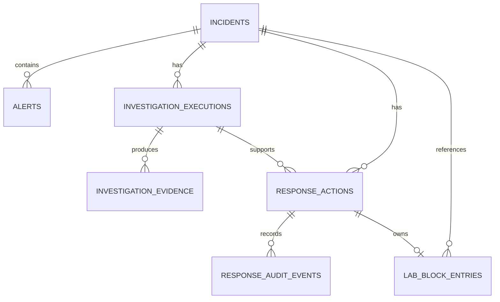

**Incident** has severity, status, title, and timestamps. **Alert** identifies `(source, source_event_id)`, event type, source IP, observed/received time, and an original JSONB payload. Although the schema allows multiple alerts per incident, the current generic ingestion path creates a new incident for each new event; it does **not** perform cross-alert correlation or group many independent events automatically. **InvestigationExecution** stores the source IP, retry count, scheduling time, status, lease token/owner, and expiry. **InvestigationEvidence** preserves the normalized provider result as JSONB.

**ResponseAction** references an incident and, when present, an investigation, with proposal and decision fields, execution state, result, error, and lease metadata. **ResponseAuditEvent** stores each consequential transition with a service-level actor label and JSONB metadata. **LabBlockEntry** is unique by response-action ID and records the simulated block's IP, incident, active flag, and deactivation time. It is possible for two separate executed actions to own two separate entries for the same IP; this is intentional.

The schema protects distinct failure boundaries. A unique index on `(source, source_event_id)` guards against repeat webhook deliveries, even if two requests race after both observe that the event is not yet present. A second uniqueness constraint covers `(incident_id, investigation_type, source_ip)`. A **partial unique index** prohibits simultaneous `proposed`, `approved`, or `executing` actions for the same incident, action type, and target IP. The application also checks eligibility in the API, but the database remains the final defense against concurrent inserts. See [`models.py`](https://github.com/sultanshahdev/soar-lite/blob/main/backend/app/persistence/models.py).

I chose PostgreSQL to avoid a second moving part while still using real transactions, indexes, row locks, and durable state. Compared with a Redis/Celery setup, polling a relational table is straightforward to reproduce and inspect. Its trade-offs are also real: database polling adds query load, the design is not a general scheduler, and high-volume orchestration would warrant separate load testing and possibly a broker. No throughput or scaling benchmark is claimed here.

### Idempotency is an observable behavior, not just a label

Suppose the same event is delivered twice because the sender retries after a network interruption. The API looks up the `generic` source/event pair; the first request inserts its incident and alert transactionally. If the second arrives after the first, it returns the existing alert and `duplicate: true`. If both arrive concurrently, the unique constraint rejects the losing insert and the service fetches the committed original. New events return HTTP 201; recognized duplicates return HTTP 200. This reduces duplicate logical work, while acknowledging that the webhook sender might still retry requests.

## 7. Alert ingestion: the first trust boundary

A security tool should not accept an arbitrary network request and treat it as a trusted incident. SOAR Lite exposes `POST /api/v1/ingest/generic` behind a webhook bearer secret. The separate analyst APIs require `X-API-Key`. Both check that their configured value is not an unset placeholder and compare credentials through Python's `hmac.compare_digest`; missing/incorrect values produce HTTP 401. This is a small development credential design, not per-user identity management.

Pydantic enforces required event ID, event type, severity, timestamp with timezone, and rule; it normalizes the observed time to UTC and parses canonical IPv4/IPv6 addresses. Extra fields are forbidden by the alert schema. The route accepts JSON content type and checks the declared `Content-Length` against the configured 65,536-byte threshold. **Accuracy note:** the visible route guard checks the declared length; the case study does not claim to prove a separate streaming-byte limiter for requests lacking that header.

An example **fictional** event (do not use it as evidence of an actual attack):

```json
{
  "event_id": "demo-unique-001",
  "event_type": "suspicious_login",
  "severity": "high",
  "observed_at": "2026-10-22T12:00:00Z",
  "source_ip": "8.8.8.8",
  "destination_host": "lab-server-01",
  "rule": "Repeated failed login attempts",
  "metadata": {"failed_attempts": 12, "demo": true}
}
```

`8.8.8.8` belongs to a legitimate public DNS service; its presence here is only to exercise a globally routable address accepted by the connector. The system does not conclude that this IP is malicious. The service queues an investigation **only** when `event_type` is `suspicious_login` and the source IP is globally routable. Other valid event types, private-source addresses, or missing source IPs may still produce stored alerts and incidents, but do not automatically start this investigation workflow.

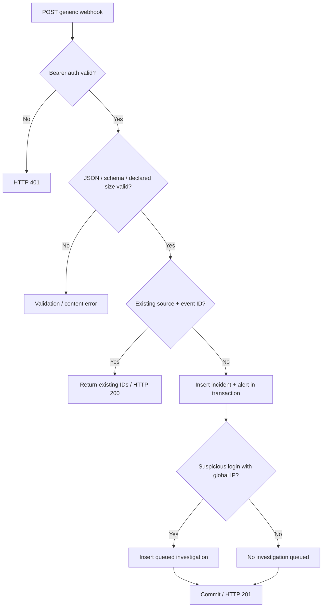

The durable commit is the hand-off between ingestion and automation. A response to a webhook means the alert was recorded; it does not mean threat intelligence was fetched or containment applied. That distinction makes the API's contract clearer and prevents a slow external provider from controlling webhook response time.

## 8. Investigation engine: durable work instead of fire-and-forget tasks

After a supported alert is stored, `InvestigationExecution` begins in `queued`. The Python worker loops over eligible investigations, then over approved response actions. Investigation claims are made through the database, not a shared in-memory queue. The worker uses `SELECT ... FOR UPDATE SKIP LOCKED` to select a due row and avoid waiting on an already locked record. It increments the attempt count, records a worker identifier and a newly generated lease token, sets an expiration, and **commits** before calling AbuseIPDB. The external HTTPS call happens after the claim transaction has closed.

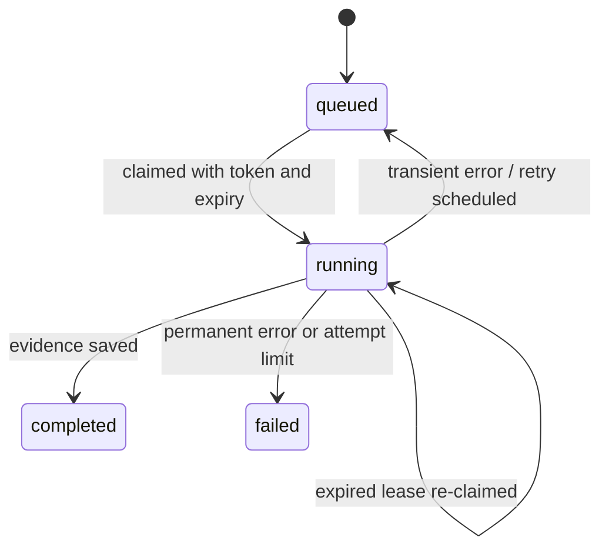

The connector is deliberately narrow: it accepts a globally routable IPv4/IPv6 address, calls AbuseIPDB's `/api/v2/check` endpoint through HTTPX with a timeout, and normalizes a small result—IP, abuse confidence score, country code when present, report count, provider name, and lookup timestamp. The evidence row stores that result as structured JSON. A zero score is a legitimate return value, not a failed investigation and not a guarantee the address is harmless.

Failures require classification. Invalid IPs, missing/invalid credentials, and bad provider payloads are terminal for the current attempt. Rate limiting, network/timeout issues, and server-side provider unavailability are transient and may be rescheduled. The worker uses bounded exponential backoff based on an environment-configured base interval and maximum attempt count; the example configuration sets three investigation attempts. At the limit, the row enters `failed` with a redacted, bounded error summary rather than retrying endlessly. A failed record is not automatically restarted just because an administrator later supplies a missing key; a fresh event is one straightforward demonstration path.

### The competing-worker problem

Consider workers A and B starting at nearly the same time. Both see an investigation in the queue. If job ownership existed only in Python memory, both processes could call the provider and both try to persist results. Here, worker A's PostgreSQL row lock excludes B from claiming the same row while A's claim is in progress. Once A commits a live lease, B no longer sees that row as eligible. This behavior is explicitly exercised with two independent SQLAlchemy sessions in a PostgreSQL worker test.

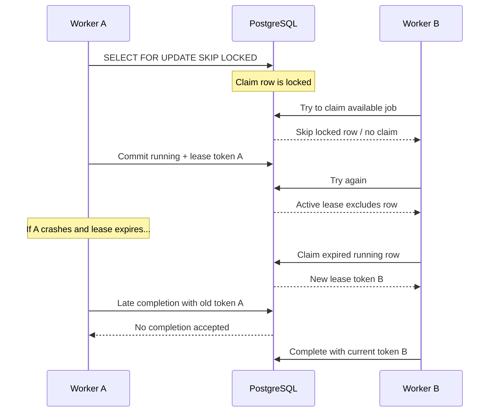

A lease provides a recovery route if a worker dies after claiming a job. The next claimant receives a different token. Completion writes check that the stored row is still `running` and carries the **same token** as the claimant; a stale worker cannot commit evidence against a newer claim. The design does not promise exactly-once external HTTP requests: a crash after the provider replies but before evidence is committed may cause the request to be repeated. It instead limits conflicting database state transitions and makes recovery possible.

### Retry and failure path

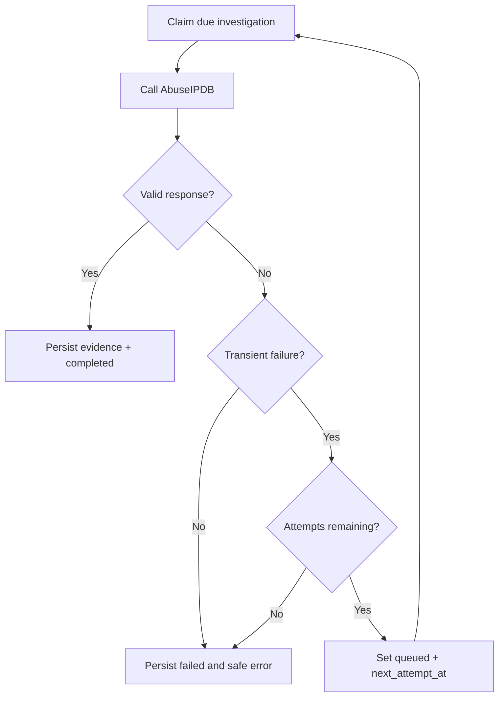

This retry loop is bounded and database-driven. The source code is clear about **at-least-once provider-call semantics** across process crashes. That limitation is part of the engineering story, not a defect to conceal. For higher-scale use, provider quotas, backpressure, richer telemetry, and more nuanced retry policies would need additional design.

## 9. Human approval and the response lifecycle

Threat intelligence should inform an analyst; it should not automatically make an operationally disruptive decision. SOAR Lite makes response authorization explicit. An analyst can propose `block_ip` only for an existing incident and a **completed investigation associated with that incident**. The target must be globally routable and match the investigation IP. A database partial unique index prevents simultaneous active proposals for the same incident/action/target.

A proposal is a stored request for a response, not a response execution. The decision API uses a conditional SQL update that only permits a transition out of `proposed`. A replayed or conflicting approve/reject request receives HTTP 409 rather than silently overwriting another decision. Proposal and decision transactions append audit events alongside the state change. The actor is labeled `analyst_api_key`, reflecting a shared API credential; this does **not** identify an individual human account.

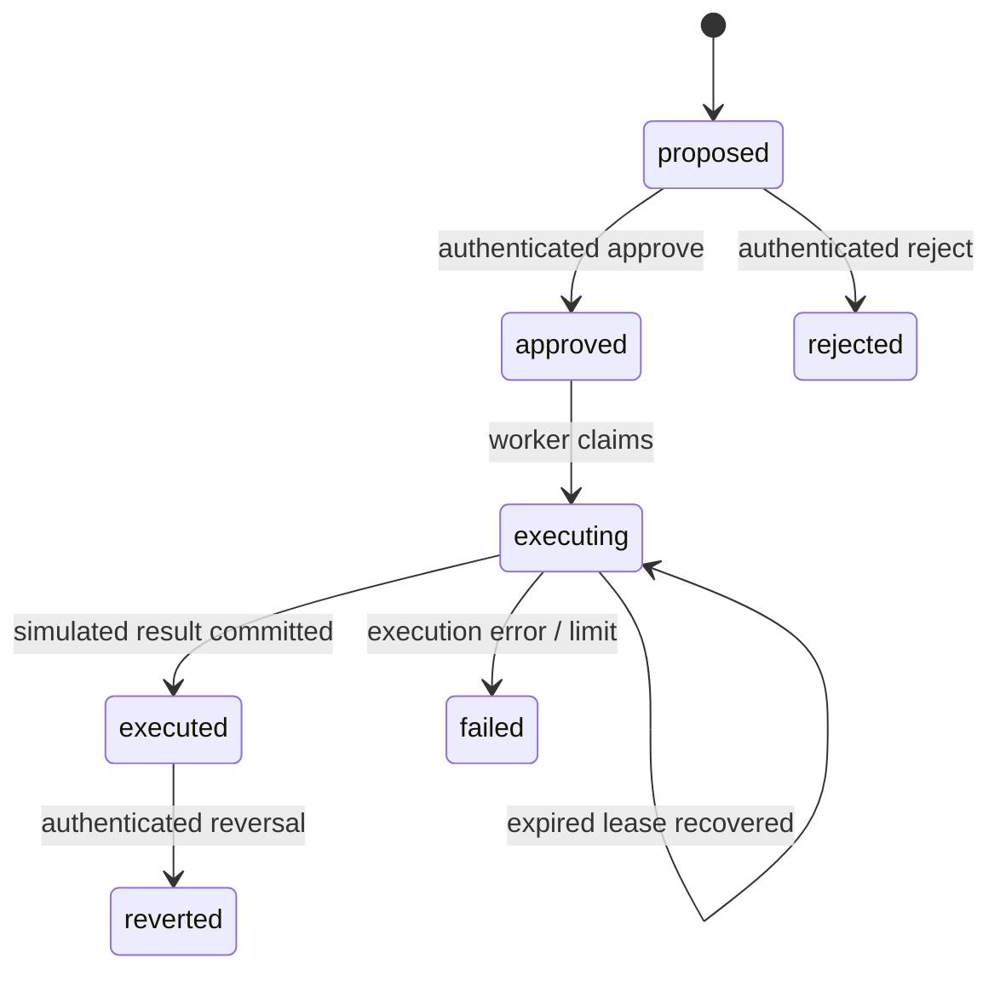

The response worker claims only `approved` actions or recoverable expired `executing` actions. It records an execution-started audit event, checks its lease token on completion, and writes the simulated block, `executed` state, execution result, and audit event in one database transaction. In this MVP, an execution exception is recorded as `failed`; a later recovery of an expired `executing` lease is possible within the configured attempt limit. Do not confuse this with an automatic retry of every failed response action.

The `LabResponseAdapter` is deliberately small. To simulate a block, it creates or reactivates a `LabBlockEntry` keyed by the response action. A second execution for that same action returns the existing entry rather than producing a duplicate logical block. To revert, the API locks the executed response action and asks the adapter to deactivate **only its owned entry**, then records `reverted` and an audit event in the same transaction. A different action owning another active entry for the same IP is unaffected. This provides an important model for reversible response effects without touching real infrastructure.

### What the audit history actually records

Events include `response_proposed`, `response_approved` or `response_rejected`, `response_execution_started`, `response_executed` or `response_execution_failed`, and `response_reverted`. Each event includes its action ID, actor label, source/target statuses, timestamp, and selected metadata. This supports operational reconstruction, but it is **not** a cryptographically tamper-proof log or a compliance-certified audit system.

The live demo used a synthetic suspicious-login event and a legitimate public IP. The blocklist entry was a simulation. No firewall rule, packet filter, Docker network policy, router, or cloud security group was modified. This restriction was central to the product's safety boundary, not an omitted deployment step.

## 10. Security architecture and threat model

The trust boundaries are straightforward but useful to enumerate. An untrusted alert sender reaches a webhook authentication dependency before the system considers the payload. An analyst browser accesses sensitive read/write APIs with a separate development credential. The backend and worker obtain database credentials from local environment configuration. The worker alone uses the AbuseIPDB key over HTTPS. The response adapter crosses no real-world containment boundary because its output is persisted lab data.

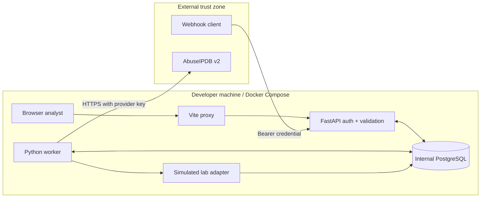

The principal risks and current mitigations are: unauthorized ingestion (bearer validation), forged analyst requests (`X-API-Key` dependency), invalid payloads (typed validation), duplicate events (unique key), overlapping workers (database claims), stale completions (lease-token checks), repeated decisions (conditional update), and hazardous containment (approval plus database-only adapter). A defined header-length check and credential secrecy contribute additional safeguards. These are **specific implemented controls**, not a blanket security certification.

The current limits deserve equal visibility. There are no individual analyst identities, RBAC, SSO, tenant separation, public reverse-proxy/TLS deployment, comprehensive key rotation workflow, managed secret store, or production security monitoring. The frontend keeps the analyst key only in browser memory; this is suitable for a narrow local demo, not a strong enterprise identity model. Local frontend/backend bindings use `127.0.0.1`, and the database service has no published host port. Secrets belong in an untracked `.env`; they are not passed into frontend JavaScript as build-time secrets.

## 11. The analyst experience

The interface makes durable state visible without requiring an operator to issue database queries. **Overview** shows incident/alert totals, unresolved counts, and recent activity; the current page of investigations is labeled as such rather than misleadingly treated as a global count. **Incidents** lists cases with severity and status and displays linked alerts. **Investigations** presents status, attempt count, associated incident, and persisted evidence, including a view of the normalized JSON. **Response Actions** lets the analyst propose eligible containment, inspect the approval/execution history, and approve, reject, or revert with confirmation. **Lab Blocklist** shows action-owned entries and active/inactive state with a clear simulation notice.

React uses a typed API client with request timeouts and error messages. The development-only analyst connection panel holds the key in memory and never asks for the webhook credential. The Vite proxy routes `/api` to FastAPI in Compose and avoids broad CORS configuration. Filters, pagination, refresh, and modest polling on running response actions help the analyst see what the worker has done. This is a practical workbench, not a claim of formal usability research or a fully accessibility-certified product.

**Evidence assets to add:** [SOC Overview], [Incident Explorer], [Investigation evidence], [Proposed/Executed action and audit trail], [Lab Blocklist active], [Reverted action and inactive entry]. See the accompanying asset plan for capture instructions and alt text. These placeholders indicate missing genuine screenshots, not fabricated screenshots.

## 12. Engineering challenges: the path was not linear

A good architecture drawing hides the mistakes and repairs that produced it. The development log captures several useful examples of why testing real persistence and process boundaries matters.

### Challenge 1 — Duplicate webhook deliveries

**Problem and risk.** Webhook senders may retry when they do not receive an acknowledgment. If every request inserts new records, one incident can trigger several investigations. **Root cause addressed.** A read-before-write existence check alone is insufficient when two HTTP requests race. **Solution.** The ingestion service combines an application lookup with PostgreSQL's unique `(source, source_event_id)` constraint. It commits incident, alert, and optional investigation together; on a uniqueness conflict it rolls back and retrieves the existing alert. **Verification.** The acceptance test submits an event twice and checks HTTP 201 then 200 with the same incident ID. **Lesson.** Idempotency needs a database-enforced identity, not just a convenient Python condition.

### Challenge 2 — Two workers claiming one investigation

**Problem and risk.** Concurrent processes could both fetch intelligence and write incompatible completion results. **Root cause addressed.** Queue state belongs in shared durable storage, not per-process memory. **Solution.** Row locks with `SKIP LOCKED` prevent overlapping claims, and persisted lease metadata excludes already-running work. **Verification.** PostgreSQL worker tests use separate sessions to prove an uncommitted lock is skipped and a committed active lease remains unavailable. **Lesson.** Concurrency claims should be tested under the actual database engine implementing the locks; in-memory or SQLite substitutes do not demonstrate PostgreSQL semantics.

### Challenge 3 — Crashes and slow providers

**Problem and risk.** An external lookup may time out or a worker may disappear after claiming work. **Solution.** Claims expire, transient errors are rescheduled with bounded exponential backoff, and every claim carries a token checked before updating completion state. **Verification.** Focused tests cover transient retry through the configured terminal limit, permanent failure, expired-lease replacement, and changed token ownership. **Trade-off.** Provider calls remain at-least-once around a crash boundary. The system avoids a stale database completion, not duplicate external API billing or rate-limit consumption in every failure scenario.

### Challenge 4 — Safe response state and reversal

**Problem and risk.** Approval and execution are different responsibilities; racing decisions or replayed actions could produce confusing results. **Solution.** The analyst API changes only `proposed` rows through conditional updates; the worker consumes `approved`, and the `LabResponseAdapter` ties each simulated block to a single action. The action result, block, and execution audit are written together. **Verification.** The acceptance test checks unauthorized approval rejection, transition to executed, a present active entry, then reversal and an inactive entry. Other response integration tests cover action ownership and duplicate execution paths. **Lesson.** Safety often comes from making state transitions explicit and recoverable, rather than adding more automation.

### Challenge 5 — Testing polluted its own database

**Problem.** Separate API and worker sessions committed rows in a disposable test database. A later integration test encountered records left by earlier tests, causing unexpected counts and claims. **Investigation.** Existing fixture rollback was not enough once independent sessions had committed. **Fix.** Tests moved to an explicitly named `soar_lite_test` database, reset and migrated the schema, and added an integration-marker-gated fixture that truncates application tables before and after each integration test while preserving `alembic_version`. **Verification status.** Historical logs show a **24 passed, 0 skipped** PostgreSQL run before later milestones. After the last fixture fix, the recorded no-test-database run was **16 passed with 18 PostgreSQL tests skipped**. The planned **34 passing tests** on the final test database were not independently confirmed in the available record. **Lesson.** Fixture ownership and committed transactions must be understood across every independent database session; green unit tests do not substitute for integration isolation.

### Challenge 6 — Real provider credentials during the live walkthrough

**Problem.** An early live investigation failed and persisted no evidence when the AbuseIPDB credential was missing. **Diagnosis.** The UI showed `failed`, while configuration checks found the provider key absent. **Fix.** The private `.env` was updated, the worker container was recreated so it loaded the new key, and a **fresh unique alert** was submitted. **Verification.** The user reported a completed new investigation with actual persisted AbuseIPDB evidence. **Lesson.** External-service configuration is an operational requirement. A failed record should remain a useful historical record; retroactively declaring it successful would conceal the sequence that occurred.

These are targeted engineering examples, not a claim that every failure mode in a production security platform has been handled. They show why I tested concurrency, boundaries, and recovery in addition to the ordinary success path.

## 13. Testing: proving system behavior at several levels

SOAR Lite has four distinct types of verification, each answering a different question. **Unit tests** check validation rules, connector transformations, and individual code paths. **PostgreSQL integration tests** exercise database constraints, independent sessions, row locks, and worker state transitions. A **lifecycle acceptance test** uses real FastAPI routes, real worker processors, and disposable PostgreSQL persistence; only the external AbuseIPDB boundary is replaced with a deterministic implementation so the test does not depend on the public service or its quota. Finally, a **manual live demonstration** checks that Docker, the React dashboard, real provider configuration, and the full workflow work together.

| Risk / behavior | Evidence | Result that can be stated |
| --- | --- | --- |
| Bad webhook credentials and invalid alert input | Authentication dependencies, alert API tests | Code and automated test coverage exist |
| Duplicate event identity | Transactional alert service and lifecycle acceptance test | Acceptance asserts HTTP 201/200 and same incident |
| Queue claiming and recovery | PostgreSQL worker tests | Historical three focused worker tests passed; implementation exercises separate sessions |
| Provider parsing and errors | Injected HTTPX connector tests | Normalized result and safe error paths are covered in code/tests |
| Completed investigation and evidence | Lifecycle acceptance test and live demo | Both simulated-provider automated path and genuine-provider manual path documented |
| Approval-only execution | Response API and acceptance test | Unauthorized approve check and approved state asserted |
| Simulated block + audit | Response worker, LabResponseAdapter, acceptance test | Action-owned active entry and audit asserted |
| Reversal | Revert endpoint and acceptance test | Reverted status, audit event, inactive entry asserted |
| Frontend build | Project development logs | `npm run build` reported passing |
| Compose configuration | Project development logs | Compose config reported valid with redaction |
| Final complete PostgreSQL suite | Test isolation fix and documented host command | **Not independently confirmed** after the latest fix |
| Final live browser workflow | User-confirmed eight-stage walkthrough | **Passed according to manual report** |

### What the acceptance test proves—and what it does not

The test at [`backend/tests/test_end_to_end_acceptance_postgres.py`](https://github.com/sultanshahdev/soar-lite/blob/main/backend/tests/test_end_to_end_acceptance_postgres.py) submits an alert and duplicate, verifies a queued investigation, invokes the processor with a deterministic provider result, checks persisted evidence, proposes and approves a response, invokes response execution, checks audit and active block state, and reverts. This is stronger than mocking database writes, but it does **not** prove the real AbuseIPDB service was reachable during that automated test, that a live browser works, or that the system meets a specific performance target.

The final full-suite invocation belongs against a **deliberately disposable** PostgreSQL database named `soar_lite_test`. Its fixtures can reset a schema and truncate application data. They must never be pointed at the application database. Without `TEST_DATABASE_URL`, integration tests are intentionally skipped, so a passing unit-only run must not be reported as full PostgreSQL coverage.

### The eight-stage live demonstration

The developer then manually followed a complete demonstration in the local Compose stack, reporting each step as successful: **(1)** services and health, **(2)** analyst authentication, **(3)** a fresh alert accepted with HTTP 201 and `duplicate: false`, **(4)** incident/investigation visible, **(5)** a newly completed investigation with real AbuseIPDB evidence, **(6)** proposal and approval followed by `executed`, **(7)** a corresponding active simulated block and approval/execution audit trail, and **(8)** `reverted` with an inactive action-owned block and reversal audit. This is meaningful *manual end-to-end evidence*. It is not a replacement for independently captured CI logs or a final passing database test report.

**Suggested portfolio evidence:** show a real screenshot of the investigation details, a response audit timeline, and the inactive block after reversal. Each should be labeled *synthetic demonstration data*; redact private identifiers and any credentials.

## 14. Local deployment and developer experience

The app runs as four Docker Compose services: **PostgreSQL**, **backend**, **worker**, and **frontend**. PostgreSQL is internal to the Compose network, keeps its data in a named volume, and has a health check. The backend waits for a healthy database, runs `alembic upgrade head` on startup, then serves FastAPI. The worker starts as `python -m app.workers.main` and shares backend code and environment. The frontend serves the React/Vite app and proxies `/api` requests to the backend service.

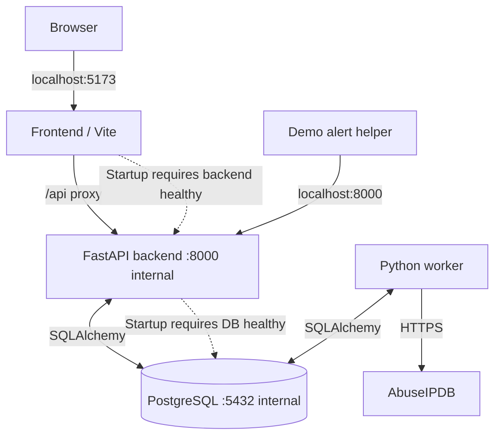

The host publishes the frontend on `127.0.0.1:5173` and the backend on `127.0.0.1:8000` by default. PostgreSQL has no host port. Credentials come from an untracked `.env` copied from `.env.example`: separate webhook, analyst, and AbuseIPDB keys plus database settings. The dashboard's analyst key is held in browser memory; the webhook and provider keys are not placed in frontend source. This is a **local development deployment**, not a public hosted service.

The final documentation work shortened the new-user path. With Git, Docker Compose v2, Bash, OpenSSL, and curl available, the repository offers these commands:

```bash
git clone https://github.com/sultanshahdev/soar-lite.git
cd soar-lite
bash scripts/setup.sh
bash scripts/start.sh
bash scripts/demo-alert.sh
```

The setup script copies the template when necessary, creates distinct random local credentials, and can collect the AbuseIPDB key without echoing it. The start helper runs the existing Compose stack. The demo helper generates a unique event ID and UTC timestamp and submits a synthetic login alert to the actual webhook, without asking the reader to compose JSON. These helper scripts passed syntax/static checks in the development record, while their standalone runtime execution in Codex's restricted sandbox was **not verified** because Docker socket access was unavailable. The live application itself was manually verified on the user's machine. Full setup instructions and troubleshooting remain in the [repository README](https://github.com/sultanshahdev/soar-lite#quick-start).

## 15. Architecture decisions and trade-offs

Each decision reflects an MVP objective and a cost. Listing alternatives does not mean every alternative was built or benchmarked.

| Decision | Chosen approach and rationale | Trade-off / when I would revisit it |
| --- | --- | --- |
| **ADR-01 · Process architecture** | Modular monolith with separate API and worker processes, shared Python domain models | Simple deployment and debugging; would reconsider service boundaries if independent scaling or team ownership justified them |
| **ADR-02 · Job execution** | PostgreSQL polling, row locks, and leases instead of Redis/Celery | One fewer service and transactional state; broker may help with heavy throughput, scheduling, and richer backpressure |
| **ADR-03 · Investigation scope** | One defined `suspicious_ip` workflow for `suspicious_login` | Verifiable end to end; generalized playbook DSL would need execution semantics, sandboxing, and migration rules |
| **ADR-04 · Decision authority** | Explicit analyst approval before response worker execution | Safer demonstration and visible accountability; adds manual time to response |
| **ADR-05 · Response boundary** | Action-owned PostgreSQL blocklist instead of live firewall changes | Reproducible and reversible without network risk; does not prove a real firewall connector |
| **ADR-06 · Analyst identity** | Single development `X-API-Key` rather than full user accounts | Low setup friction; unsuitable for individual accountability, RBAC, and production access controls |
| **ADR-07 · Local deployment** | Docker Compose on localhost, database unexposed | Reproducible environment; no high-availability architecture or hosted operations claim |
| **ADR-08 · Provider testing** | Deterministic connector in automated acceptance test plus separate live AbuseIPDB walkthrough | Stable test results; live integration must still be checked and depends on third-party quotas/connectivity |

These choices enabled a useful constraint: every major capability had to become observable in one traceable path. The system could then be demonstrated without concealing incomplete enterprise integrations under a large architecture diagram.

## 16. Results: what exists at the end

The final MVP provides authenticated alert intake, incident records, conditional investigation creation, actual AbuseIPDB integration, durable evidence, concurrency-aware workers, explicit approval decisions, simulated containment, audit history, and selective reversal. A functional React console exposes that state, while Docker Compose and helper scripts make local reproduction approachable. The strongest result is **workflow completeness**: an alert can be followed to an authorized action and back to an inactive lab entry with the history preserved.

The results should not be misread as measured operational improvement. There are no verified user counts, production incident statistics, latency gains, detection accuracy, cost savings, or large-scale performance numbers. Source and tests support particular correctness properties; the manual demonstration supports integrated functionality; neither constitutes an enterprise deployment evaluation.

### What was demonstrated versus what remains open

- **Manually demonstrated:** local running stack, authenticated analyst view, accepted synthetic alert, completed real-provider enrichment, proposal/approval, simulated execution, audit, and reversal.
- **Source- and test-supported:** database-backed identities, worker claims, lease tokens, bounded retries, response gating, action-owned idempotent blocks, disposable-database acceptance path.
- **Not independently established after final fixture changes:** one complete latest PostgreSQL test-suite run with all integration tests passing.
- **Not implemented:** on-host firewall rules, network attack sensing, per-user RBAC, general playbook authoring, large-scale production deployment.

## 17. What I learned

This project changed how I think about automating sensitive operations. The difficult part was not calling a reputation API; it was designing what happens **before and after** that call. A legitimate webhook can be delivered twice. Two workers can observe the same queue. A network request can time out after work has started. A user can approve an action twice. And an action must be undoable without accidentally undoing somebody else's state.

The strongest improvements came from treating those situations as design requirements: give each event a stable identity, commit related records together, claim work through PostgreSQL, fence stale completion with lease tokens, keep a human decision boundary, and model simulated response ownership explicitly. Writing focused integration tests also showed me how easily a test suite can become misleading when independent database sessions leak state between tests.

I also learned the value of deliberate scope. Implementing one complete workflow taught me more about orchestration and recovery than adding a dozen integrations without a reliable acceptance path. Finally, the documentation pass mattered: a system is much more convincing when another engineer can find the architecture, understand the trade-offs, start it locally, and follow the same demonstration.

## 18. Limitations and future direction

The current design is intentionally small. It accepts generic webhooks rather than ingesting live telemetry from a SIEM or EDR. It schedules one investigation type instead of executing a general playbook language. The interface uses a shared API key rather than individually attributable accounts. All containment is simulated, and there is no claim of formal security review, comprehensive accessibility testing, hosted availability, or proven horizontal throughput.

If I expanded it, the next steps would be evidence-driven: add individual analyst accounts and RBAC; improve metrics and structured observability; introduce browser-level automated tests; connect a specific upstream alert source; and add another intelligence provider behind the existing connector boundary. A real response integration would require policy constraints, a separate authorization model, blast-radius controls, and isolated testing before touching network infrastructure. A generalized playbook engine or separate broker would be justified only after the fixed workflow's operational limits were measured.

## 19. Conclusion

SOAR Lite began as a focused question: *Can I automate the routine parts of investigating a suspicious IP while preserving a deliberate, auditable human decision before response?* The resulting system answers that question with a working local workflow and visible state throughout the process. It uses practical backend mechanisms—transactions, uniqueness constraints, leased workers, retries, and an approval state machine—to make a cybersecurity concept concrete. Its safety limits are equally intentional: real reputation lookups, **simulated** blocking, and honest verification boundaries.

**Explore the implementation:** [GitHub repository](https://github.com/sultanshahdev/soar-lite) · [Architecture reference](https://github.com/sultanshahdev/soar-lite/blob/main/architecture.md) · [Installation and demo](https://github.com/sultanshahdev/soar-lite#quick-start)
