# c2g — Code 2gether

**A decentralized, peer-to-peer collaborative code editor for a trusted local network.** Each participant runs a desktop application, keeps a local copy of the document, and exchanges editing operations directly with other peers. No central collaboration server orders the edits.

**What this case study demonstrates:** application-layer TCP protocol design, UDP discovery, thread-safe peer sessions, deterministic replicated state, causal recovery, durable local storage, native desktop integration, and evidence-based release engineering.

| Project facts | Evidence-backed description |
|---|---|
| Type | Python desktop collaborative text/code editor; substantial modernization of MIT-licensed P2PDocs |
| Communication | UDP announcements for discovery; framed TCP sessions for peer state and operations |
| Consistency | RGA-inspired character CRDT, Lamport IDs, stable anchors, tombstones, full-state merges |
| Interface | Monaco Editor in pywebview, bundled offline via Vite |
| Persistence | Validated versioned JSON, local autosave, atomic replace, backup and recovery |
| Test result | **68 passing Python tests**, including a **100-seed three-replica** convergence test, in the M7 report |
| Release evidence | Ubuntu 24.04.4 x86_64 GTK/X11 source and frozen automation; **G6 PARTIAL**, not a public release |
| Repository | [sultanshahdev/c2g](https://github.com/sultanshahdev/c2g) |

> **Hero asset:** Capture a real c2g window with syntax-highlighted text and the Connections sidebar, ideally alongside a second real peer window. Do not substitute a mockup: the evidence is stronger when the screenshot shows a running build. Suggested caption: *Two desktop peers edit the same locally replicated document through direct TCP connections.* Only use that caption after recording the actual two-window scene.

## 1. The project in one minute

Collaborative editing looks simple from the outside: two people type into the same file, and both see the result. Underneath, it presents several distinct engineering problems. A network carries bytes, not structured operations. Two users can insert at the same position before either sees the other's change. A disconnect can divide one document into multiple, independently edited histories. A restart can erase the identifiers that make later merges possible. And a visually working desktop window is not necessarily a working editor.

c2g addresses those problems within a deliberately narrow scope: trusted local networks, direct peer connections, and locally stored documents. A Python process acts as both a client and a TCP listener. A UDP discovery worker advertises its presence; users then explicitly connect. Connected peers exchange versioned, length-framed JSON messages. Each peer maintains a character-level replicated data structure rather than treating the current visible text as the sole source of truth. The CRDT stores immutable character identities, positional anchors, and deletion records so replicas can reconcile concurrent operations without a server deciding a single global edit order.

The project did not begin as a blank repository. It modernized the existing MIT-licensed P2PDocs editor. Early research found correctness problems in the CRDT, missing connection-time reconciliation, brittle GUI behavior, and unsafe/ineffective persistence. The work was therefore sequenced around correctness first: repair replica ordering, make networking reliable, prove the Monaco bridge, integrate a desktop controller, add safe persistence, package the application, then execute end-to-end validation. The final M7 report records 68 passing Python tests, deterministic multi-replica convergence checks, working real loopback TCP integrations, and a tested Linux desktop release-candidate artifact. Windows runtime, physical two-machine discovery, Docker execution, and complete human GUI acceptance were still open at the recorded gate.

The engineering lesson is the project's central theme: **reliable transport does not create consistent replicated state**. c2g had to solve transport, protocol lifecycle, causal ordering, recovery, and persistence as separate problems.

## 2. Problem definition and scope

### What problem was the system built to explore?

Small groups working on the same machine-local project or trusted LAN may benefit from directly sharing an editable document. A central collaboration service is one architecture; it is not the only one. For a self-contained desktop prototype, a direct peer model can remove the need to host a collaboration backend while giving the developer an opportunity to implement real distributed-systems behavior. That was the engineering motivation—not a claim that market research proved demand or that the tool is a commercial competitor to existing editors.

Three cases shaped the design. First, a peer needs to discover another machine and establish a connection. Second, participants must be able to make overlapping modifications without discarding one person's work. Third, temporary disconnection and process restart must not destroy the metadata needed for reconciliation. These cases require more than a socket connection and a text widget.

### Goals and non-goals

The functional target was a native editor with local document creation and recovery, explicit peer connections, shared editing, disconnect/reconnect, and UTF-8 export. Its engineering targets were deterministic convergence under supported delivery histories, bounded protocol processing, safe ownership of mutable state, resilient local persistence, and a testable headless core.

Equally important were the boundaries. c2g did **not** promise internet-scale peer discovery, NAT traversal, cloud collaboration, end-to-end encryption, authenticated remote peers, distributed consensus, or large-document performance guarantees. The protocol is for a **trusted LAN**. A peer connected to a shared document can read and modify that document. Keeping those assumptions visible makes the system easier to explain and its claims easier to defend.

## 3. Requirements reconstructed from the engineering record

The following are **reconstructed engineering requirements**, based on documented plans, implementation and tests—not claims of formal customer interviews.

| ID | Requirement and reason | Implemented area | Evidence/status |
|---|---|---|---|
| FR-01 | Create, edit, resume and export local documents | Desktop application, Monaco, persisted CRDT | M4/M5; M7 automated coverage |
| FR-02 | Discover local peers without a registry service | UDP `PeerDiscovery` | Announcement parser tested; two-machine broadcast still unverified |
| FR-03 | Explicitly connect to a compatible peer | TCP `NetworkManager`, HELLO | M2 real loopback tests |
| FR-04 | Keep separate replicas while exchanging edits | `CRDTDocument` + framed OP messages | M1/M2/M7 tests |
| FR-05 | Support simultaneous edits and eventual reconciliation | Lamport IDs, anchors, tombstones | 100 three-replica seeds |
| FR-06 | Rejoin after interruption and exchange missed history | Full-state snapshots and relay | M7 two-/three-peer regressions |
| FR-07 | Preserve identities and deletion history after restart | `PersistedCrdt`, JSON schema | M5 and M7 restart tests |
| NFR-01 | Avoid interpreting arbitrary TCP reads as entire messages | Four-byte framing and buffered decoder | M2 fragmentation/coalescing tests |
| NFR-02 | Avoid unbounded peer/session growth | Peer, handshake, frame and queue caps | M7 limits and rejection tests |
| NFR-03 | Keep GUI and network callbacks from racing over document state | Controller/CRDT/session locks | M4 architecture and integration tests |
| NFR-04 | Survive an interrupted save without overwriting the only valid backup | Validated atomic primary/backup writes | M7 fault-injection regression |
| NFR-05 | Work from locally bundled editor assets | Vite and PyInstaller onedir | Linux frozen and asset smoke |

User-oriented acceptance examples were: *discover an editor on my LAN; connect explicitly; see remote changes; edit while disconnected; rejoin without replacing my changes; reopen the same document after restart.* They informed tests, but no external user-study result is asserted here.

## 4. Starting point: P2PDocs, not a greenfield rewrite

The predecessor was a Python/Tkinter text editor with an RGA-inspired CRDT, TCP/UDP network modules, and a pickle-based persistence path. The [original P2PDocs project](https://github.com/taaha-0548/P2PDocs) is credited in c2g's MIT-licensed repository, and its history was preserved. The starting source already contained significant components; the contribution of c2g is the subsequent correction, restructuring, integration, testing and modernization.

The initial architecture review identified concrete problems. Ascending sibling-ID ordering could turn an intended middle insertion into an append. Tombstones could be lost or ignored when messages arrived in an unexpected order. Connection establishment did not consistently reconcile full document state, and remote operations did not reliably propagate across more than two peers. The Tkinter editing layer coupled interaction handling with networking; common edits such as paste, undo and Delete were difficult to handle completely. Normal startup could discard saved state, while pickle-based recovery was inappropriate for loading untrusted data.

| Dimension | Earlier P2PDocs baseline | Modernized c2g |
|---|---|---|
| Desktop interface | Tkinter editor | Monaco inside pywebview; Python controller owns document |
| CRDT | RGA-inspired, known insertion/deletion failures | Deterministic anchored ordering; causal buffering; tombstones; tested merges |
| Networking | Incomplete peer lifecycle and synchronization | Framed protocol v2, identities, bidirectional snapshots, relaying, caps |
| Storage | Pickle path, startup-reset issues | Strict JSON schema, New/Resume, autosave, atomic primary and backup |
| Verification | Baseline had limited reliable automated evidence | 68 Python tests and targeted desktop/packaging checks in M7 |
| Distribution | Legacy package metadata | Python 3.12+ metadata, Vite assets, Linux PyInstaller onedir |

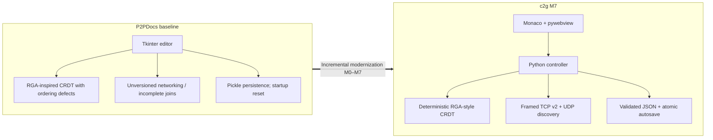

*Figure 1 — The work modernized and corrected the existing codebase instead of claiming every inherited component was written from scratch.*

## 5. Development strategy: correctness before polish

The milestones were dependency-driven. A beautiful interface would not compensate for divergent replicas; persistent state could not be trusted until its underlying CRDT model was correct. The plan put model and protocol correctness ahead of visual modernization, then validated every integration boundary separately.

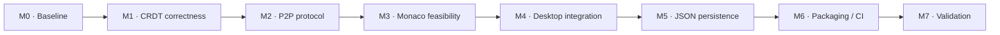

*Figure 2 — Milestones were ordered to resolve CRDT and protocol correctness before desktop polish and packaging.*

| Phase | Question it answered | Main result and evidence |
|---|---|---|
| **M0** — Baseline | What is broken, what must be preserved? | Characterization tests, planning records, repository rebrand and attribution |
| **M1** — CRDT | Can independent replicas converge without losing edits/deletes? | Anchored ordering, pending causality, monotonic merges; **G1 PASS** |
| **M2** — Networking | Can several peers join, exchange and recover state safely? | TCP protocol v2, UDP discovery, relay dedup; automated loopback tests; physical LAN still pending |
| **M3** — Feasibility | Can Monaco run inside a Linux-native Python host? | pywebview bridge, Unicode conversion, worker loading, batch insertion; **G3 PARTIAL** for cross-platform evidence |
| **M4** — Desktop | Can real UI edits and remote operations use one CRDT authority? | Controller/bridge architecture; Monaco replaces default Tk launch |
| **M5** — Persistence | Can replica identity and history survive restart? | JSON schema, recovery, autosave, New/Resume, locks, packaging metadata |
| **M6** — Distribution | Can offline assets and native process launch together? | Linux onedir, headless simulation, Windows build workflow, Docker definition, sanitizer patch |
| **M7** — Validation | Which claims survive fault injection and end-to-end testing? | 68 passing tests, three serious defects fixed, Linux artifact verified; **G6 PARTIAL** |

Not every intermediate gate was formally complete: some remained partial because Windows, physical LAN or human input testing could not be run in the available environment. That distinction is part of the engineering record, not an omission.

## 6. The decentralized architecture

A c2g **peer is a full application instance**, not simply a browser tab or thin client. It owns its editor, Python controller, CRDT replica, TCP listener, discovery worker and on-disk state. Peers exchange records and reconcile local copies; there is no authoritative cloud process to which all keystrokes must be submitted. A peer can also open a document without any other participant connected.

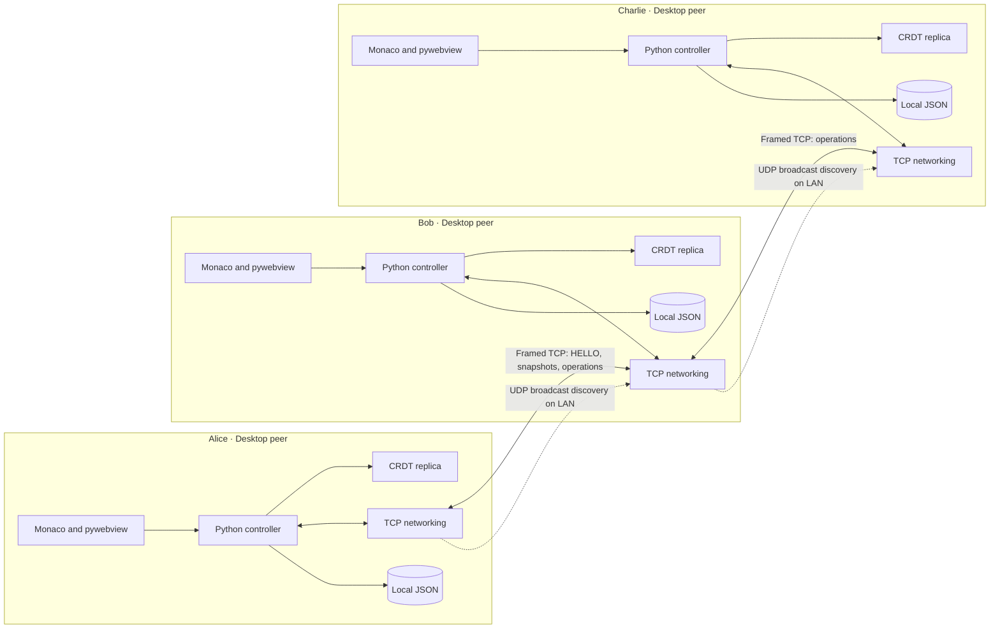

*Figure 3 — A chain is sufficient for three-way propagation. Every box represents an independent replica and local storage; the dashed broadcasts are discovery, not document updates.*

Within one instance, the Monaco UI is presentation and user intent. The pywebview bridge exposes a limited set of commands. `ApplicationController` validates those commands and serializes mutations against the CRDT. `NetworkManager` owns TCP session framing, handshake, deduplication and forwarding. `PeerDiscovery` owns UDP announcements. `PersistedCrdt` connects document mutations to a queued, validated JSON snapshot writer. Separating these components made it possible to test real protocol behavior without launching GTK.

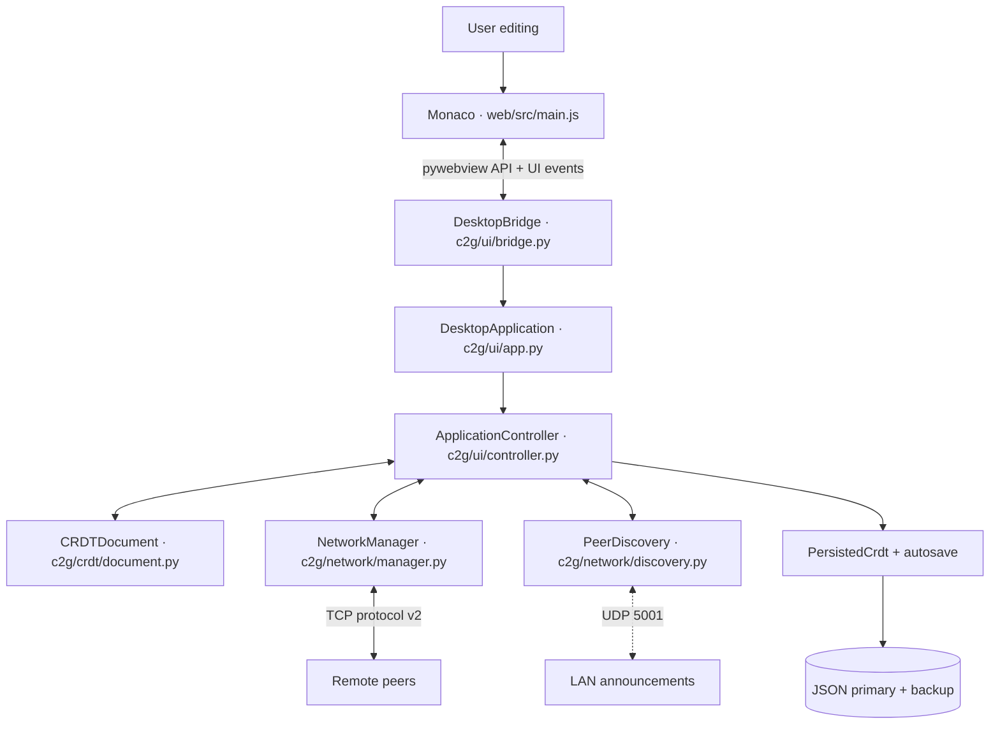

*Figure 4 — The authoritative document remains on the Python side; the editor displays that document and submits transactional edits.*

An important distinction emerged during release validation: pywebview can start a **random loopback-only HTTP server** for bundled local assets even when its `http_server=False` argument is used. M7 observed that service bound to `127.0.0.1`, rooted at `web/dist`, while the intentional peer TCP listener binds `0.0.0.0` for LAN communication. The presence of a loopback asset server does **not** mean that collaboration is centrally hosted, nor does it justify saying the desktop application has no local HTTP listener. Saved JSON documents live under a different storage directory, not the asset root.

## 7. Network engineering: discovery, transport and protocol

### 7.1 Two transports, two responsibilities

The distinction between discovering a peer and exchanging application state drove the hybrid networking design. `PeerDiscovery` broadcasts small UDP announcements on port **5001**. They contain a c2g protocol marker and version, a peer ID, display name and the sender's actual TCP listening port. A receiving process validates the announcement, associates it with the sender's IP address, and expires stale entries based on **local monotonic receipt time** rather than trusting a remote timestamp. The original implementation does not try to create TCP sessions as a side effect of discovery: the person using the editor chooses **Connect**.

UDP is appropriate for this local presence announcement because a broadcast is lightweight and does not require a preexisting connection. Its failure to deliver is not a failure of document correctness: a peer can still be entered manually by address. The data plane then uses TCP because synchronization benefits from ordered, reliable byte delivery. However, TCP delivers an arbitrary **stream of bytes**. A single `recv()` is not equivalent to one complete application message; reads may contain partial frames or several concatenated frames.

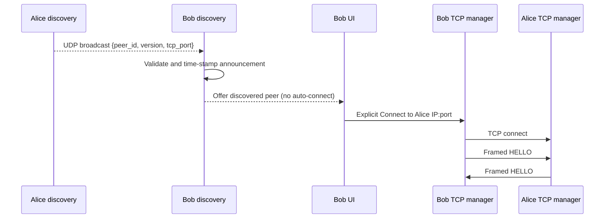

*Figure 5 — Discovery identifies a candidate endpoint; explicit user action starts the direct TCP handshake.*

### 7.2 A deliberately small application-layer protocol

`c2g/network/manager.py` defines **protocol version 2**. Each message is serialized as a UTF-8 JSON object with a **four-byte unsigned big-endian length prefix**. The receiver buffers incoming bytes and only attempts JSON decoding when the declared frame length has arrived. The implementation checks that the length is positive and no greater than **12 MiB**, bounds the receive buffer, and rejects malformed UTF-8, invalid JSON and non-object frames.

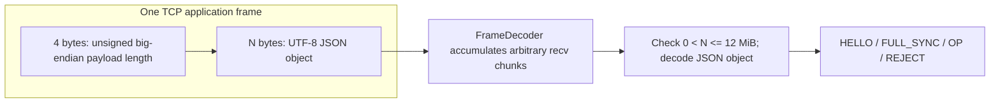

*Figure 6 — The four-byte prefix solves message-boundary recovery on top of TCP's byte stream; JSON carries the application envelope.*

The core functions are [`encode_frame` and `FrameDecoder`](https://github.com/sultanshahdev/c2g/blob/main/c2g/network/manager.py). A concise excerpt captures the design:

```python
# Extracted from the repository's framing logic.
return len(raw).to_bytes(4, "big") + raw
```

The tradeoff is direct: JSON plus length framing is inspectable and easy to test, but larger than a purpose-built binary protocol. A 12 MiB frame cap limits a single payload, not aggregate throughput or memory under hostile traffic; the protocol was not designed for untrusted Internet exposure. Protocol versioning lets peers reject incompatible clients instead of silently interpreting different message semantics.

### 7.3 HELLO: identity and compatibility before editing

A TCP connection alone is insufficient to decide that two processes should share a document. Both sides exchange framed `HELLO` objects with **protocol version, stable peer UUID, username, document UUID, actual listener port, required capabilities and explicit join intent**. The accepted capability set includes support for right anchors, pending tombstones and state synchronization. Incoming peers reject mismatched versions, unsupported capabilities, self-connections, malformed identities, and unrelated nonempty documents.

An **explicitly empty** joining document may adopt an existing peer's logical document ID. That ID transition is persisted; independent local replica identifiers remain distinct. This prevents a newly opened empty document from being rejected unnecessarily while avoiding accidental merges between two unrelated nonempty documents. Duplicate sessions are handled using deterministic peer identity preference rather than allowing unlimited parallel connections for the same peer.

```mermaid
sequenceDiagram
  participant A as Alice outgoing TCP
  participant B as Bob incoming TCP
  A->>B: HELLO v2, peer UUID, document UUID, capabilities
  B->>A: HELLO v2, peer UUID, document UUID, capabilities
  A->>A: Validate version, capabilities, peer and document
  B->>B: Validate version, capabilities, peer and document
  alt compatible identity or explicit empty join
    A->>B: FULL_SYNC snapshot
    B->>A: FULL_SYNC snapshot
    A->>A: Flush bounded pending operations
    B->>B: Flush bounded pending operations
  else incompatible / unrelated nonempty document
    B-->>A: REJECT when possible; close connection
  end
```

*Figure 7 — Capability and document validation precede accepted snapshot exchange; a mismatch yields rejection rather than an unsafe merge.*

### 7.4 Synchronization is a lifecycle, not one message

A new `PeerSession` begins in `SYNCING`. During the handshake both sides initiate a `FULL_SYNC` snapshot, capturing **immutable CRDT elements, anchors, visibility/tombstones and pending deletes**. Operations created while the session is synchronizing enter a bounded per-session pending queue. A per-session send lock ensures the queued operations are flushed after the snapshot so that local edits do not overtake the initial state boundary. After that boundary, the session is marked `READY` for normal operation exchange.

The word `READY` does not mean every peer on a network has globally converged at that instant; the M2 report defines it operationally as the reciprocal snapshot exchange having been initiated. That nuance matters because asynchronous deliveries, multi-hop propagation and reconnect scenarios still require eventual reconciliation.

```mermaid
stateDiagram-v2
  [*] --> Connecting
  Connecting --> Handshaking: TCP connected
  Handshaking --> Rejected: Invalid HELLO / document mismatch
  Handshaking --> Syncing: Valid HELLO
  Syncing --> Ready: Snapshot sent; buffered operations flushed
  Ready --> Closed: Disconnect / transport error
  Rejected --> Closed
  Closed --> [*]
```

*Figure 8 — The practical TCP session lifecycle. `Rejected` and `Closed` are conceptual diagram outcomes, not claims that the implementation exposes distinct enum objects for them.*

### 7.5 Multi-peer operation relay

In a three-peer chain—Alice ↔ Bob ↔ Charlie—Charlie can only see Alice's change if Bob forwards it. In a cycle, forwarding without duplicate suppression risks circulating the same operation repeatedly. c2g wraps application messages in an `OP` envelope carrying a **stable message ID**. A bounded seen-message cache suppresses reprocessing, and relays exclude the immediate sender. The M2 report records a **20,000-entry** seen cache, with peer-session and handshake limits of **16** and a per-session sync queue of **1,000** packets.

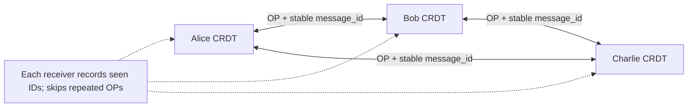

*Figure 9 — A repeated logical operation is filtered by message ID, even if multiple network paths deliver it.*

M7 uncovered a subtle second propagation failure. When Charlie rejoined, a full-state snapshot reached Alice but not Bob, who remained connected to Alice. Bob could therefore miss Charlie's tombstone. The fix relayed **nonempty directly received FULL_SYNC state** through the existing message-ID-controlled OP mechanism, excluding the incoming session. A regression test proved that all three replicas then converged in full state without forcing a separate Bob reconnection. That failure shows why two-peer integration alone does not establish correct multi-peer behavior.

### 7.6 Errors and limits as first-class protocol behavior

The actual tests include fragmented/coalesced frames, partial-frame disconnects, unsupported HELLO versions, invalid JSON, oversized frames, simultaneous cross-connections, duplicate sessions, refused connections and unavailable listener ports. The server accepts peers in worker threads with timeouts. Importantly, socket closing and blocking sends are kept outside the global peer-map lock where possible. A malformed peer should not be able to corrupt a different session's CRDT state simply by violating framing expectations.

That is not a claim of full denial-of-service resistance. It is a concrete improvement in input validation and resource ownership within the stated trusted-LAN scope.

### 7.7 Offline reconciliation after a dropped connection

When connectivity returns, peers repeat document identity checks and send full CRDT snapshots. The merge includes tombstones and unresolved causal state, not just the current text. The test suite covered both sides making independent edits, reconnecting, then restarting with their saved identities and continuing to edit.

```mermaid
sequenceDiagram
  participant A as Alice
  participant B as Bob
  A->>B: Connected and synchronized
  Note over A,B: TCP connection lost
  A->>A: Offline local insert / delete
  B->>B: Offline local insert / delete
  B->>A: Reconnect; framed HELLO
  A->>B: FULL_SYNC with elements/tombstones/pending deletes
  B->>A: FULL_SYNC with elements/tombstones/pending deletes
  A->>A: Commutative compatible CRDT merge
  B->>B: Commutative compatible CRDT merge
  Note over A,B: Convergence under tested supported assumptions
```

*Figure 10 — Reconnect repeats bidirectional state exchange rather than copying a winner’s visible text.*

## 8. The replicated document: why the CRDT exists

Imagine that Alice and Bob both see `AB`. Alice inserts `X` between `A` and `B`, while Bob—before seeing Alice's message—inserts `Y` in the same gap. If each peer merely sends its current full text, whichever copy arrives last can overwrite the other person's edit. Reliable TCP does not solve that semantic conflict; it only transports whichever bytes were sent.

c2g's `CRDTDocument` instead records each character as an element with a stable identity and positional relationships. An element has a `CRDTId(client_id, lamport_clock)`, its character, a predecessor `after_id`, an optional right-side `before_id`, and a visibility flag. The IDs are not screen offsets: screen positions change as other inserts arrive, but a character's identity does not. A local logical clock advances when creating new character elements and is restored safely when state is loaded or merged.

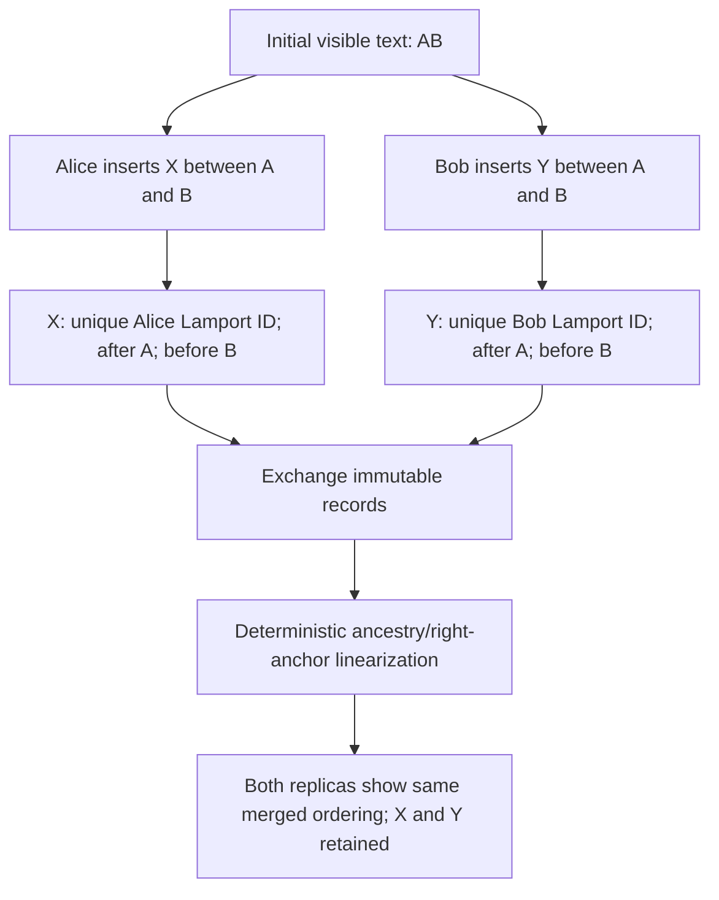

*Figure 11 — Both inserts survive. Their exact final ordering follows the implementation's deterministic ordering rules; the diagram intentionally does not invent an ID comparison outcome.*

### 8.1 Anchors and deterministic order

The starting CRDT implementation had a significant position bug. An insertion requested in the middle of `AB` could be placed after `B` because sorting siblings by ID did not preserve the user's visual gap. M1 introduced the **right anchor** (`before_id`) alongside the traditional RGA predecessor. In the simple regression `AB` plus `X@1`, the desired text is `AXB` rather than `ABX`. A new insertion at the head similarly uses its right-side neighbor to remain before old head elements.

Rendering is not a naive sort over raw IDs. The modernized implementation resolves ancestry and then performs iterative topological linearization over predecessor and optional right-anchor constraints. If independently formed right-side constraints conflict, candidates are considered in stable ID order and a cycle-closing *optional* right edge can be discarded; immutable predecessor ancestry is not discarded. This is an implementation-specific choice that produces deterministic ordering under the tested conditions.

### 8.2 Out-of-order operations and tombstones

A distributed receiver can see a child insertion before its predecessor, or a deletion before the original insertion. The correct response is not to drop the operation. The engine retains unresolved inserts indexed by missing predecessor and tracks unknown deletions in `pending_deletes`. When the missing element arrives, resolution cascades and pending deletion state is applied. Deletes mark records invisible rather than destroying their identity and place in the ancestry graph. Tombstone visibility is **false-dominant**: a later snapshot cannot make a deleted record visible again.

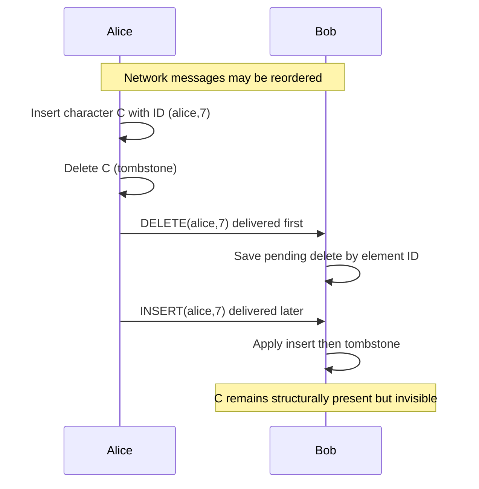

*Figure 12 — A delayed insert is still deleted because the receiver saved the deletion intent by immutable element ID.*

Snapshots are also **merged**, not assigned wholesale. For compatible immutable records, each replica unions known elements, combines deletion state, validates ancestry, and advances logical clocks as needed. Duplicates are idempotent. Conflicting immutable data claiming the same ID is rejected. This gives convergence under the algorithm's supported assumptions without needing a central sequencer. It is important not to describe this as a consensus algorithm or a formal mathematical proof.

### 8.3 Unicode, batches and performance discipline

Monaco reports change ranges in **UTF-16 code units**. Python strings are indexed by Unicode code points. With emoji and other supplementary characters, the numeric offsets can differ. The bridge converts offsets and rejects boundaries that split surrogate pairs, so a user action cannot accidentally delete half of a character representation. M3 tested emoji, combining marks, RTL text and multiline replacement.

An early feasibility experiment exposed a non-network performance cost: inserting text one character at a time repeatedly recomputed visible ordering and serialized state. M3 introduced `insert_local_batch`, which resolves the initial gap once, creates one immutable CRDT record and Lamport tick **per code point**, and persists the batch once. In the report's **in-memory-persistence** spike, a 10,003-code-point insertion was applied in **0.179 seconds**, followed by a **0.059-second** text read. Those are scoped local measurements, **not** end-to-end network latency, throughput or a general large-document performance guarantee.

## 9. Editing end-to-end: Monaco to the remote replica

The production UI uses Monaco inside pywebview, not a web-based central application. On a local edit, JavaScript collects a transaction with a base version and UTF-16 change ranges. It serializes those transactions through a queue. `DesktopBridge` forwards the request to `ApplicationController`, which checks versions and ranges and applies changes against the authoritative Python CRDT. For compound edits, deletion ranges are processed in the appropriate order to avoid offset shifts. The controller emits CRDT messages for networking and schedules the persistence snapshot. Remote operations are applied to the same CRDT engine and returned to the editor as incremental patches rather than replacing the entire text on every update.

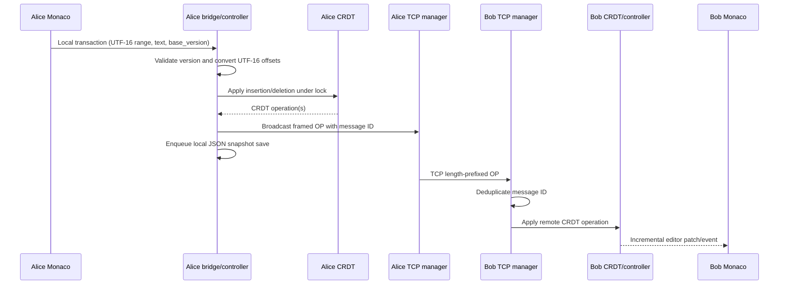

*Figure 13 — One local edit becomes a CRDT mutation and an application-level network operation; Monaco is a view, not the replication authority.*

A programmatic remote patch must not be mistaken for a new local user edit, or it would echo the operation back into the network. The editor integration uses an explicit remote-application guard and versioned transaction acknowledgments. This is one of the less visible but essential boundaries between a graphical editor and a distributed model.

```mermaid
sequenceDiagram
  participant U as Monaco UI
  participant JS as JS event queue
  participant API as pywebview DesktopBridge
  participant C as ApplicationController
  participant D as CRDT
  U->>JS: onDidChangeModelContent event
  JS->>API: apply_local_transaction (UTF-16 offsets)
  API->>C: Validate base_version and transaction
  C->>D: Convert ranges; apply CRDT ops
  D-->>C: New document state / remote messages
  C-->>API: Accepted or rejected; version
  API-->>JS: Bridge result
  JS-->>U: Update status / process next transaction
  Note over U,D: Remote patches avoid echoing themselves as local edits
```

*Figure 14 — The editor sends intent and receives acknowledgment; version validation prevents silent stale transaction application.*

## 10. Concurrency, thread ownership and lock boundaries

A desktop peer handles input, network reads, network writes, discovery announcements and filesystem writes at overlapping times. c2g does not hand every subsystem an unrestricted reference to the same mutable data. `ApplicationController` owns a re-entrant lock around authoritative document mutation. `CRDTDocument` also guards its internal state. `NetworkManager` has a peer-registry lock and each `PeerSession` has its own send lock. Discovery protects its peer list. The persistent document owns a single autosave writer and cross-process advisory lock for a local storage key.

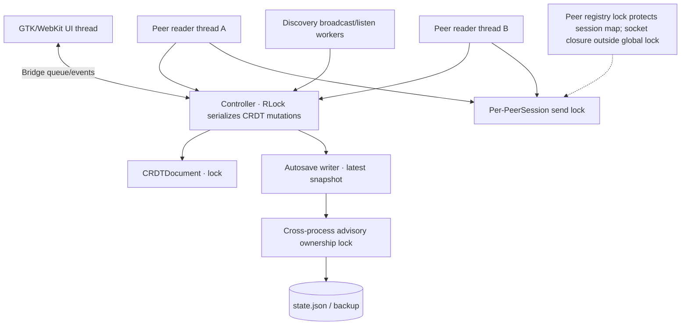

*Figure 15 — Different locks protect different invariants. The diagram describes ownership boundaries, not a literal single shared lock across all peer sessions.*

The network layer intentionally avoids holding a global session lock while writing or closing sockets. Such operations can block on an unavailable peer and stall otherwise healthy connections. A closing session also checks that it is still the expected session for its peer ID: an old receiver must not remove a replacement connection after reconnect. The UI bridge similarly separates background network callbacks from GTK/Monaco presentation updates.

This design is more than “uses multithreading.” It specifies **which state is mutable, who owns it, which operations can block, and when a thread may hand an event to another subsystem**. That is the core of a thread-safe application architecture.

## 11. Persistence that preserves the *replica*, not just the text

If c2g saved only `"Hello"`, reopening would restore visible content but lose Lamport identities, tombstones, predecessor anchors, pending deletes and the logical document relationship to other peers. A future reconnect could then produce identity collisions, resurrect deleted characters or fail to recognize existing history. That is why the persistent representation contains validated **CRDT state**, including document and replica metadata.

M5 introduced `JsonDocumentStore` with schema `c2g-document`, version 1, stored under an isolated `documents/<storage-key>` directory. The normal application path uses `PersistedCrdt` and **does not automatically deserialize historical pickle files**. `--new` creates a new local replica and document; `--resume STORAGE_KEY` loads one validated persisted state. Different local replicas of the same logical shared document retain different storage keys and replica IDs.

Saves serialize deterministic UTF-8 JSON to a same-directory temporary file, flush and `fsync` it, and atomically replace the primary file. The previous *valid* primary may be retained as a backup. Loading validates primary state, then attempts the backup if necessary; invalid primary and backup copies are not overwritten simply to let startup continue. Autosave coalesces snapshots, reports completed saves or errors to the UI, and flushes and joins its worker during normal shutdown. Per-document advisory locking prevents two local processes from writing the same saved replica simultaneously.

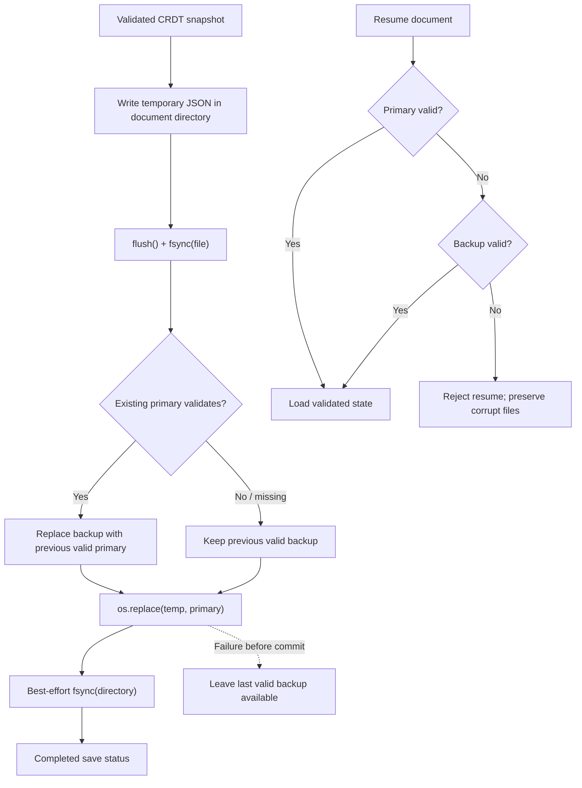

*Figure 16 — The important invariant is retaining a recoverable prior state when a new commit fails, not claiming protection from every possible hardware fault.*

**The M7 save-recovery defect** illustrates why durability requirements need fault injection. After recovering from a corrupt primary using a valid backup, a subsequent save could rotate the corrupt primary over that sole good backup. If the final replacement then failed, neither file would be recoverable. A regression reproduced the exact sequence. The revised save first validates an existing primary before rotating it, preserving the last valid backup if commit fails.

M7 also detected a failed-resume resource leak: a cyclic ancestry record could be rejected only **after** an autosave writer and ownership lock had started. Validating that state before acquiring those resources allowed the process to exit cleanly and a later opener to regain ownership. The lesson is that recovery correctness includes both on-disk bytes and the lifecycle of resources opened during recovery.

## 12. Native desktop integration and document workflow

The modernization retained Python for the CRDT and sockets while replacing the default Tkinter interface with **Monaco Editor** hosted by **pywebview**. M3 was a feasibility gate: Linux GTK launched a native window, initialized the Monaco worker, and proved the local JavaScript/Python bridge. M4 turned the spike into an `ApplicationController` and `DesktopBridge` boundary. The frontend stays locally bundled, with no runtime CDN requirement. The user can create or resume documents, edit in Monaco, view connection state, connect/disconnect peers and export UTF-8 text.

A typical document lifecycle is: launch → select New/Resume → activate controller and TCP listener → edit locally → connect to peers → exchange and apply CRDT operations → autosave → close → reopen → reconnect and merge. The application does not start a document's CRDT/listener/writer until the startup choice is made. In source and frozen runs, the desktop host reads the built `web/dist` assets. Actual native export-dialog and physical clipboard acceptance remained on the M7 manual checklist; automated bridge/export tests are not equivalent to physically exercising the full dialog.

One practical bug surfaced after packaging. The `Continue working` picker remained visible even when JavaScript had set `hidden` on its element. The CSS selector `#picker { display: grid }` overrode the default hidden display behavior. A targeted `[hidden] { display: none !important }` rule, plus a remote-patch startup-handler correction, restored interaction. Regression testing isolated that browser behavior; the GTK automation and subsequent frozen source checks confirmed the fix. This is a useful example of a small frontend rule masking otherwise functioning network and persistence subsystems.

## 13. Engineering failures that shaped the system

Failures are presented as implementation evidence, not as marketing anecdotes. The following were documented in the milestone reports and verified by regressions.

| Failure | Root cause | Corrective decision | Verification |
|---|---|---|---|
| Middle insert `AB` + `X@1` produced `ABX` | Pure sibling ID order ignored a requested visual gap | Add stable right anchor and deterministic topological ordering | M1 REG-01; `AXB` expectation |
| Remote delete arrived before insert and disappeared | Unknown deletion not preserved | Retain pending tombstone keyed by immutable element ID | M1 causal-delivery regressions |
| Deleted characters reappeared after snapshot | Merge replaced tombstone visibility | False-dominant visibility join and immutable record validation | M1 tombstone/snapshot tests |
| Three-peer rejoin left Bob without Charlie's deletion | Full-state snapshot stayed connection-local | Relay nonempty received FULL_SYNC via deduplicated OP envelope | M7 real TCP three-peer regression |
| Startup dialog remained above Monaco | `display:grid` defeated the HTML hidden attribute | Explicit `[hidden]` CSS rule | Picker browser/GTK checks |
| Failed save could destroy last valid backup | Corrupt primary rotated over a recovered backup | Validate primary before backup rotation | M7 injected replacement failure |
| Cyclic resume leaked writer/ownership | Validation ran after resource acquisition | Validate ancestry before opening writer/lock | M7 subprocess regression |
| Bundled sanitizer contained an advisory-affected dependency | Monaco's sanitizer import resolved an older DOMPurify build | Scoped Vite resolver and pinned 3.4.17 | Production npm audit and bundle inspection |

The range of bugs is revealing. The CRDT defects were **semantic**: messages delivered correctly could still produce the wrong text. The three-peer defect was **topological**: local and two-peer behavior concealed a missing forwarding path. The persistence defect was **transactional**: an attempted protection mechanism removed the last recovery copy. And the picker bug was **presentational**: the application state had progressed, but the user could not interact with it. Each required a different debugging approach and a corresponding layer-specific regression test.

## 14. Testing strategy and what it really establishes

Testing was structured to separate deterministic model behavior from platform-dependent behavior. Pure CRDT tests cover inserts, deletes, anchors, cycles, causal delays and invalid state. Framing tests cover split TCP reads, combined frames, bad lengths and malformed payloads. Socket tests use ephemeral loopback listeners and bounded polling to exercise real TCP send/receive behavior without relying on fixed ports or arbitrary sleeps. Persistence tests use temporary directories and injected failures. GTK and frozen tests exercise resource loading and synthetic native input. Each layer increases integration scope without pretending to validate more than it observes.

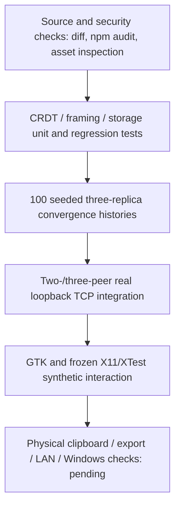

*Figure 17 — The evidence moves from algorithmic and protocol checks to real sockets and native desktop automation. Human and cross-platform gates remain separate.*

The final M7 run recorded **68 passed in 12.22 seconds**, exiting normally. The randomized suite used **100 deterministic seeds (0–99)**, **three replicas** and **30 generated edits per seed**. It varied insertion positions, Unicode/newlines, partial and reversed deliveries, duplicate operations, delayed predecessors, pending deletes, stale snapshots and final all-to-all merges. Assertions checked not only rendered text but also element identities, anchors, visibility and pending state. Failed assertions included the seed, making regressions reproducible. The report describes this as bounded randomized evidence, **not a formal proof**.

The two-peer integration created and resumed real persistent controllers, exchanged actual protocol-v2 TCP frames, inserted and deleted concurrently, used multiline Arabic/emoji/combining marks, edited while disconnected and reconciled after restart. The three-peer suite covered a chain, a cycle, duplicate delivery and the rejoin/tombstone propagation regression. This is stronger evidence than merely showing two editor windows with matching text, because it validates the metadata required for future reconciliation.

| Area | M7 evidence | Boundary |
|---|---|---|
| Python regression suite | 68 passed; normal process exit | Test suite is not formal verification |
| CRDT randomized convergence | 100 deterministic three-replica seeds | Does not prove arbitrary histories or unbounded scale |
| Two-/three-peer networking | Actual TCP loopback integration passed | Physical two-machine UDP discovery not tested |
| Persistence | Corruption, backup, locking, restart, injected failures | Not immunity to hardware loss or unsaved-process termination |
| Native desktop | GTK/X11 source and PyInstaller synthetic pointer/keyboard smoke | Full physical clipboard and export-dialog acceptance pending |
| Frontend/security | Vite production build; npm production audit zero at run time; bundled DOMPurify 3.4.17 | Not an audit of all future dependencies or malicious peer behavior |
| Windows / Docker | Workflow and Dockerfile defined | Build/runtime and Docker daemon execution not verified at G6 |

An important metric discipline applies: the **68 tests** count automated Python test cases, while **100 seeds** describe iterations *inside* a convergence test; they should not be summed and presented as 168 tests. Likewise, the in-memory paste spike is not a P2P latency result.

## 15. Security model and operational boundaries

The system's trust model is explicit: peers communicate on a **trusted local network** through an **unauthenticated, unencrypted application protocol**. It is not intended to expose the TCP or UDP discovery ports to the public Internet. Version, capability and document identity checks prevent certain accidental mismatches, but they are not peer authentication. The finite 12 MiB frame size, 16 peer and 16 handshake caps, 1,000-entry sync queues and bounded dedup records reduce specific resource risks; they are not complete protection against denial of service. Connected peers can receive and change the selected document.

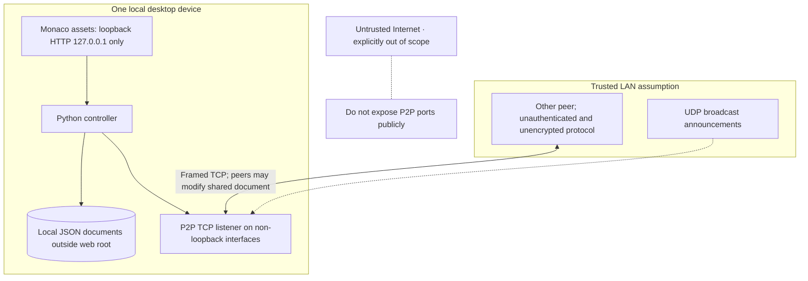

*Figure 18 — The local frontend asset server is loopback-only; P2P transport crosses onto the trusted LAN. The Internet is outside the approved threat model.*

For storage, strict JSON validation replaces unsafe automatic pickle loading. The local HTTP asset root is separate from document profiles. A traversal attempt to fetch repository content outside the asset root was rejected in M7. The production npm audit found no vulnerabilities at the time it was run and the shipped frontend included the remediated sanitizer; these outcomes do not establish perpetual dependency safety. This honest scope statement is important when discussing the project's engineering maturity.

## 16. Build, packaging and how the application runs

The release pipeline combines Python with a compiled local web frontend. `web/` is built with npm/Vite into `web/dist`, including Monaco workers. `scripts/build_desktop.py` and `c2g.spec` create a PyInstaller **onedir** bundle, with resource resolution supporting both source and frozen layouts. Desktop data is stored outside the distribution. The complete folder—including `_internal` resources—must be distributed; copying the executable alone is insufficient.

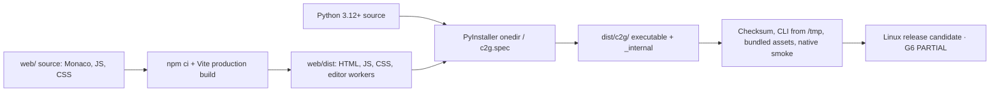

*Figure 19 — Offline editor assets become part of the native folder; a checksum and launch smoke are verification steps, not cloud deployment.*

The source README documents a Python 3.12+ environment and source asset build:

```bash
# Example from a source checkout; GTK/WebKitGTK host dependencies are separate.
python -m pip install -e '.[desktop]'
cd web && npm ci && npm run build && cd ..
python -m c2g alice --new --listen-port 5000
```

For a **same-machine two-peer** test, use separate profiles and TCP listener ports. Launch Alice on 5000 and Bob on 5002, then manually connect Bob to `127.0.0.1:5000`; ensure each process initially has its own storage key. The README also supports `c2g alice --resume STORAGE_KEY`. For the frozen Linux build, the executable is `dist/c2g/c2g`, and `C2G_STORAGE_ROOT` can point at a disposable profile.

M7 rebuilt the Linux artifact once after its Python fixes. The recorded release-candidate onedir directory occupied approximately **363 MiB** of filesystem space, with **96 frontend asset files** totaling around **14 MB**, including Monaco workers. The executable had a SHA-256 manifest and passed a foreign-working-directory CLI smoke and GTK/X11 frozen interaction. The exact artifact hash belongs to the M7 report; a later rebuild should not reuse that hash. Packaging did not publish a GitHub Release, PyPI package or signed installer.

### Platform readiness at the recorded gate

| Target | State on 24 October 2026 |
|---|---|
| Ubuntu 24.04.4 x86_64, GTK/WebKitGTK, X11 | Source and frozen automation verified; **human release-candidate acceptance pending** |
| Other Linux / Wayland | Not fully qualified |
| Windows / WebView2 | Workflow configured; desktop build artifact and native runtime **not verified** |
| macOS | Not verified |
| Docker | Definition exists; daemon denied access; tests **not executed** in Docker |
| Two-machine physical LAN | Manual procedure defined; UDP discovery across machines **not verified** |

This status does not prevent presenting c2g as a strong engineering portfolio project. It does prevent describing it as a fully supported cross-platform public release.

## 17. Tradeoffs rather than slogans

| Decision | Why it suited this scope | Cost or limitation |
|---|---|---|
| Direct peers, no central editor service | Preserves local-first behavior and exposes real distributed-state challenges | No NAT traversal, cloud relay or access-control server |
| UDP discovery plus TCP transport | Lightweight presence announcements and ordered byte delivery | Broadcast may be filtered; user still connects explicitly |
| Framed JSON protocol v2 | Visible semantics, testable boundaries and compatibility checks | JSON payload overhead; custom protocol maintenance |
| RGA-style CRDT | Concurrent edits merge without central edit sequencing | Tombstones and causal state consume memory; complex ordering invariants |
| Bidirectional full-state snapshots | Reconnection can recover missed state | Large snapshots; frame/state limits; no claim of scalable incremental history compression |
| Deduplicated relaying | Allows chains/cycles without unbounded repeated OP handling | Bounded cache has finite retention; no hostile-network guarantee |
| Threaded Python networking | Integrates with the inherited Python core and desktop host | Lock ownership and blocking socket behavior require care |
| Monaco inside pywebview | Familiar editor functions with native application shell | Renderer dependencies and UTF-16/Unicode bridge complexity |
| Validated JSON with atomic replace | Human-inspectable format and recoverable on-disk state | JSON state can grow; fsync cannot prevent every filesystem/hardware fault |
| PyInstaller onedir | Bundles Python and offline editor assets | Large artifact and platform-specific build/acceptance burden |

## 18. Lessons and next technical questions

**Message delivery and state correctness are independent.** TCP handled ordered bytes, while the CRDT had to give those bytes meaning under concurrent edits and late delivery. **Stable identity matters more than visible text.** The persisted replica must preserve metadata that an editor normally hides. **Reconnection is a protocol phase.** Explicit HELLO, snapshot exchange, deduplicated relay and bounded queues were necessary; simply reopening a socket was not enough. **Failures must be tested at the layer where they occur.** The M7 snapshot bug required a three-peer topology, the backup bug required fault injection, and the picker bug required browser rendering inspection. **Platform evidence is not portable.** A successful Linux artifact does not prove Windows/WebView2 behavior.

Future work could add authenticated and encrypted peer transport, internet connectivity/NAT traversal, verified Windows/macOS distributions, deeper physical LAN acceptance, better collaborative presence, and investigated CRDT history compaction. Each changes the threat model, consistency behavior or implementation complexity. None should be presented as a shipped feature.

## 19. Outcome and release decision

The project reached a working, testable **Linux release candidate for human acceptance**. The evidence supports a decentralized desktop application with a custom framed TCP protocol, UDP discovery, RGA-style replicated editing, three-peer message forwarding, reconnect reconciliation, safe local persistence and comprehensive headless validation. The reported M7 test suite passed **68 tests**, and its randomized convergence test passed **100 three-replica seeds**. No unresolved demonstrated P0/P1 defect remained in the executed scope, but required acceptance environments were missing.

**Final gate: G6 PARTIAL.** That is a more useful engineering conclusion than an unsupported “production-ready” label: it states exactly what is known, what was tested, and what a release owner must still verify. For a technical portfolio, c2g demonstrates not just the ability to assemble components, but the judgment to identify failure modes, preserve architectural boundaries, design reproducible tests and stop short of claims the evidence cannot defend.

---

## Source references and historical attribution

- [c2g repository and README](https://github.com/sultanshahdev/c2g/blob/main/README.md)
- [Original P2PDocs project](https://github.com/taaha-0548/P2PDocs) — original contributors and retained MIT attribution
- [Implementation plan M0–M7](https://github.com/sultanshahdev/c2g/blob/main/docs/IMPLEMENTATION_PLAN.md)
- [M1 CRDT correctness](https://github.com/sultanshahdev/c2g/blob/main/docs/M1_CRDT_CORRECTNESS_REPORT.md)
- [M2 networking reliability](https://github.com/sultanshahdev/c2g/blob/main/docs/M2_NETWORK_RELIABILITY_REPORT.md)
- [M3 Monaco feasibility](https://github.com/sultanshahdev/c2g/blob/main/docs/M3_MONACO_FEASIBILITY_REPORT.md)
- [M4 desktop integration](https://github.com/sultanshahdev/c2g/blob/main/docs/M4_DESKTOP_INTEGRATION_REPORT.md)
- [M5 persistence and recovery](https://github.com/sultanshahdev/c2g/blob/main/docs/M5_PERSISTENCE_RECOVERY_REPORT.md)
- [M6 release tooling](https://github.com/sultanshahdev/c2g/blob/main/docs/M6_RELEASE_TOOLING_REPORT.md)
- [M7 final validation and support matrix](https://github.com/sultanshahdev/c2g/blob/main/docs/M7_FINAL_VALIDATION_REPORT.md)
- [CRDT implementation](https://github.com/sultanshahdev/c2g/blob/main/c2g/crdt/document.py), [TCP manager](https://github.com/sultanshahdev/c2g/blob/main/c2g/network/manager.py), [UDP discovery](https://github.com/sultanshahdev/c2g/blob/main/c2g/network/discovery.py), [JSON storage](https://github.com/sultanshahdev/c2g/blob/main/c2g/storage/json_store.py), [UI controller](https://github.com/sultanshahdev/c2g/blob/main/c2g/ui/controller.py)

**Evidence cutoff:** repository content and milestone reports retrieved for this case study, including the 2026-10-24 M7 report. GitHub source links use branch paths, not immutable commit permalinks; pin to a reviewed commit before publishing. The archive accompanying this case study is a portable documentation package—not a commit to the developer's local repository.
